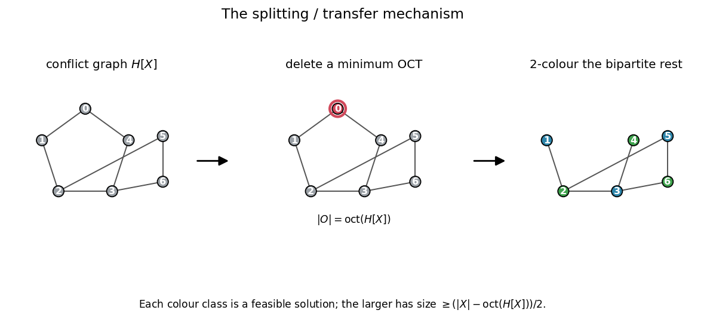
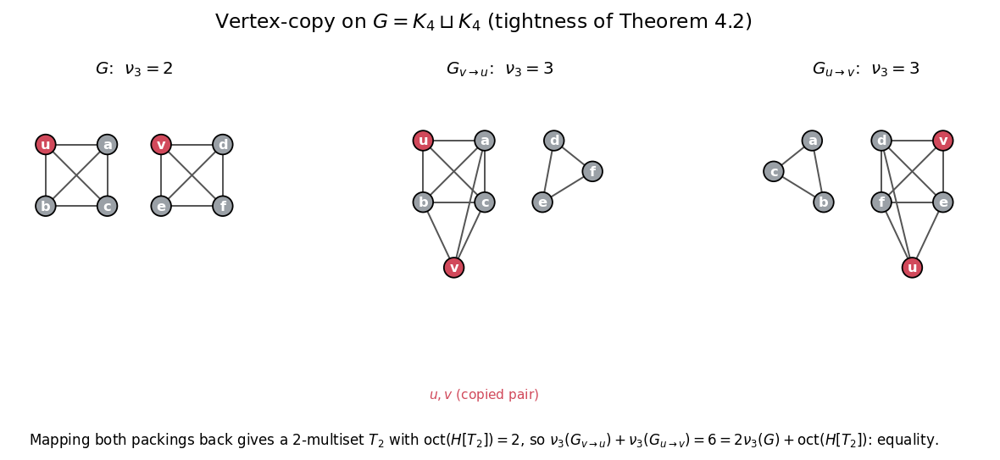
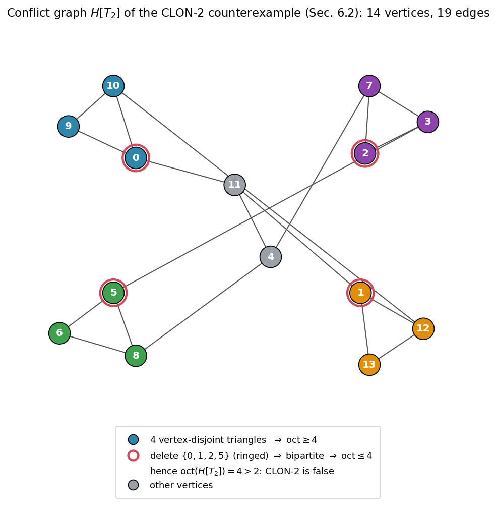

# Colorability and Realizability Defects in Resource-Dominated Packing Relaxations

**Juan Pablo Traverso Gianini**  
Independent researcher, Santiago, Chile  
[jtraverso@gmail.com](mailto:jtraverso@gmail.com)  
[ORCID: 0009-0003-6068-4096](https://orcid.org/0009-0003-6068-4096)

**Paper V in the series — Preprint 1.0**  
**Date:** October 18, 2026  

**MSC 2020:** Primary 05C70; Secondary 05C15, 05C85, 90C27.

## Abstract

A fractional packing describes how much of each object can be used, but an integral packing
must also resolve conflicts between the selected objects. We study finite bounds for the
loss in this passage. Deleting copies until their conflict graph is \(q\)-colorable gives
a transfer bound in terms of the weighted colorability defect. We extend this bound to
classes which admit realizations in a fixed weighted target system, allowing the realizing
objects to differ from the original copies. The resulting loss is the deletion weight plus
the sum of the realization losses. Bipartite list edge coloring supplies exact host
realizers; on a \(K_{r,r}\) family these remove a quadratic auxiliary colorability defect.
Applications include integral vertex-copy inequalities, exact pure-profile LP values, and
certification of host-clique packings. The SEAL construction combines exact regimes with
local improvement and an independent rational upper-bound certificate. Its guarantees
distinguish feasibility, exactness under structural hypotheses, and the certified error of
an individual output.

**Keywords:** triangle packing; fractional packing; colorability defect; realizability
defect; list edge coloring; copy inequality; packing certificates.

## 1. Introduction

Many packing problems admit a useful fractional description before they admit a useful
integral construction. A resource constraint can bound the total load on each edge or
incidence, while leaving open how to select mutually compatible objects. We consider a
finite version of this problem: given a fractional solution, or simply a multiset of
candidate objects, how much value must be lost when producing a feasible packing?

One answer comes from coloring. Form a graph whose vertices are the occurrences of the
objects and whose edges record conflicts, including conflicts between repeated copies of
one object. After deleting a set that makes this graph \(q\)-colorable, a largest color
class gives a feasible packing. For weighted objects, the same argument selects a heaviest
class. If the multiset was obtained by scaling a fractional solution by \(q\), the deleted
weight divided by \(q\) bounds the loss. This elementary observation separates the
combinatorial selection step from the choice of the fractional solution.

### 1.1. From independent classes to realizable classes

Independence can be a stronger requirement than an application needs. A class of requests
may admit a packing after its objects are reassigned to suitable hosts. Requiring the
original class to be independent would discard requests that such a construction could
retain. Our main formulation records the cost of realizing a class in a fixed target
system.

Suppose that the occurrences of a weighted multiset \(X\), outside a deletion set \(Z\),
are partitioned into \(q\ge1\) classes \(C_1,\ldots,C_q\). Suppose further that each class
has a feasible realization \(R(C_i)\) in the same target system, losing at most \(r(C_i)\)
weight. Theorem 4.2 gives a class whose realization satisfies
\[
|X|_w\le q\,w_{\mathsf T}(R(C_i))+w(Z)+\sum_{j=1}^q r(C_j).
\]
The proof is an averaging argument. The substantive work in an application is to construct
the realizations and control their losses. When each independent class realizes itself,
the minimum certificate cost is exactly the weighted colorability defect (Theorem 4.4).

Host assignments give a concrete separation. Regard the edges of \(K_{r,r}\) as requests,
with \(r\) hosts available to each edge. Keeping only an independent class in its line graph
retains at most \(r\) requests. A proper host assignment realizes all \(r^2\) requests as
edge-disjoint host triangles. Example 5.5 makes this comparison precise, including the
target system. Galvin's theorem [18] and its local extension by
Borodin--Kostochka--Woodall [19] provide broader exact realization criteria.

### 1.2. Copies and certified constructions

The vertex-copy operation supplies a second application. For nonadjacent vertices \(u,v\),
let \(G_{v\to u}\) replace the neighborhood of \(v\) by that of \(u\). Mapping triangle
packings from the two opposite copies back to \(G\) produces a multiset \(T_2\). Its
conflict graph measures the loss in the integral inequality
\[
\nu_3(G_{v\to u})+\nu_3(G_{u\to v})
\le 2\nu_3(G)+\operatorname{oct}(H[T_2]).
\]
Theorem 6.2 proves this statement for the chosen optimal copied packings. The additional
structure of their mapped conflicts gives the sharp bound
\(\nu_3(G_{v\to u})+\nu_3(G_{u\to v})\le3\nu_3(G)\).
Mixed triangle and \(K_4\) packings require a different error accounting, treated in Section 7.

For an explicit construction, a useful certificate need not identify an optimum in advance.
Corollary 4.6 separates the gap between feasible primal and dual values from the cost of
realizing the scaled primal solution. Section 8 then develops SEAL
(*Schedule–Estimate–Audit–Lock*) for host-clique packings. It uses exact constructions in
the pure and stated bipartite regimes, and local improvements elsewhere. A feasible output
\(R\) and a valid rational dual value \(U\) give
\[
|R|\le\nu\le\lfloor U\rfloor.
\]
This certificate remains valid regardless of how the construction found \(R\).

### 1.3. Context and organization

For graphs, the colorability defect used here is established terminology [15–17]; no
novelty is claimed for that parameter or its elementary coloring calculus. The present
formulation concerns its use in resource-dominated transfer, its extension to realizable
classes, and the copy and host applications. The averaging step itself is elementary.
In the standard host model, taking disjoint copies of the host palettes and coloring each
local edge by its underlying pair gives a restricted rainbow-matching formulation. The
associated color-line graph and general rainbow-matching algorithms are studied by
Le--Pfender [29]. Stamoulis [30] studies deletion of whole color classes to obtain residual
conflict graphs with exact relaxation or structural properties. That grouped-deletion
parameter differs from our weighted deletion of occurrences and the separate cost of
realizing classes in a fixed target system. We use these works as context, not as a
hardness classification of the restricted host model or an approximation guarantee for
the particular N1/N2 search below.
The use of fractional structure in integral reduction has a classical precedent in
Nemhauser--Trotter theory [9]. Haxell--Rödl [10] and Yuster [11] compare integral and
fractional packing asymptotically, whereas our bounds keep a finite certificate-dependent
error. Krivelevich's work [12] provides related context for triangle packing and covering.

An earlier exact connection between clique partitions and a colorability deficit is due to Wallis and Zhang [31, Proposition 3.2]. For an independent join they express the clique partition number through the maximum total order of a colorable subfamily of core cliques, with a charge for the core partition. For edge-and-triangle partitions in their subcubic setting, their analysis further separates triangle and deletion costs. This is a concrete antecedent to defect accounting through colorability; the present paper concerns weighted transfer and realization certificates in a fixed target system, together with the copy and host applications.

Paper IV [25] proves an all-order bound \(c_4(G)\le M(n)+b\) for chordal graphs, with an absolute constant \(b\), and the exact maximum \(M(n)=\lfloor n(n+1)/6\rfloor\) for all sufficiently large orders. This implies the \(n^2/6+O(n)\) bound asked in Erdős Problem 81 [14]; it does not assert \(b=0\) at every order. Okechukwu [32, Theorem 1.1 and Corollary 1.2] also proves the all-order bound up to an additive constant and the exact eventual extremal value. No priority for those extremal conclusions is claimed here. The present paper studies general finite packing and realization mechanisms, with the colorability and realizability defects measuring loss between representations.

Within the Erdős #81 series [13,14], Papers I and II study fractional triangle packing
and covering functionals [2,4], and Paper III proves a linear-error split-graph result [5].
Paper V uses the copy operation from Paper II and gives a packing-side proof of its
fractional copy inequality. The identity \(\nu_3^*=\tau_3^*\) is finite LP duality.
The integral copy statement is the contribution of the copy section. No theorem of
Paper III or asymptotic rounding theorem is used in the proofs below.

The accompanying IV–V research note [24] gives a separate certificate-based assembly of that established Erdős 81 bound using the realizable-class transfer. Completing a physical triangle/\(K_4\) packing gives
\(c_4(G)\le e(G)-L+\rho\), where \(L\) is the reference gain and \(\rho\) the
normalized certificate cost. The mixed rounding and near-extremal constructors of
Paper IV [25] supply certificates that fit the target
\(M(n)=\lfloor n(n+1)/6\rfloor\) for sufficiently large chordal graphs, with an
absolute additive correction at the remaining orders. That application retains
IV's structural localization as a proved input; the transfer inequality does not
establish the required realization cost by itself. Its proof and independent
formal project are kept in the note rather than added to the main argument here.

Sections 2–4 set up the transfer and realization statements. Section 5 constructs host
realizers. Sections 6–7 establish the copy and LP applications; Section 8 gives the SEAL
construction and its certificates. Section 9 records finite obstructions to stronger
claims. Additional structural calculus and resource-incidence interfaces are listed in
Section 6 of the formal companion. The abstract transfer theorem alone does not supply the structural
inputs for the chordal application in [24].

## 2. Conflict systems and resource-dominated relaxations

**Definition 2.1 (conflict system).** A *conflict system* is a pair
\((\mathcal O,K)\), where \(\mathcal O\) is a finite set of objects and \(K\) is a symmetric,
irreflexive relation on distinct objects. A feasible solution is an independent set
\(S\subseteq\mathcal O\). Write \(\nu(\mathcal O,K)\) for the maximum size of a feasible
solution.

Examples include edge-disjoint triangle packings, host-clique schedules, matchings, and
list edge-coloring formulations.

**Definition 2.2 (bounded-multiplicity multiset and conflict graph).** Let \(X\) be a multiset
over \(\mathcal O\). Its conflict graph \(H[X]\) has one vertex for each copy in \(X\). Two
vertices are adjacent when their underlying objects conflict; two distinct copies of the same
object are also adjacent. If each object has multiplicity at most \(q\), then \(X\) is called a
\(q\)-multiset.

**Definition 2.3 (colorability defect).** For \(q\ge1\), let \(D_q(H)\) be the minimum number
of vertices whose deletion makes \(H\) \(q\)-colorable. For \(q=2\),

\[
D_2(H)=\operatorname{oct}(H),
\]

the odd-cycle-transversal number.

For \(q=2\), \(D_2(H)\) is Dol'nikov's colorability defect [15]. For general \(q\),
\(D_q(H)\) coincides with the \(q\)-colorability defect \(\mathrm{cd}^q(H)\) of Kříž [16]
(see also Ziegler [17]) when \(H\) is regarded as a 2-uniform hypergraph. We retain the
notation \(D_q\) to emphasize its role as a vertex-deletion defect in the transfer bounds. In
particular, \(D_1(H)=|V(H)|-\alpha(H)\). No novelty is claimed for the parameter itself or for
the elementary calculus listed in the supporting-results section of the formal companion.

**Definition 2.4 (resource structure and resource LP).** A conflict system is
*resource-structured* if there is a finite set \(\mathcal R\) and a map
\(\rho:\mathcal O\to 2^{\mathcal R}\) such that two distinct objects conflict if and only if
their resource sets intersect. The resource-capacity polyhedron is

\[
P_{\mathrm{res}}
=
\left\{
x\in\mathbb R_{\ge0}^{\mathcal O}:
\sum_{o:\,r\in\rho(o)}x_o\le1
\text{ for every }r\in\mathcal R
\right\}.
\]

The resource LP maximizes \(\sum_o x_o\) over \(P_{\mathrm{res}}\).

**Definition 2.5 (resource-dominated relaxation).** A polytope
\(P\subseteq\mathbb R_{\ge0}^{\mathcal O}\) is a *resource-dominated relaxation* if

\[
P\subseteq P_{\mathrm{res}}
\]

and its \(0/1\) points are exactly the indicators of feasible solutions. Write

\[
\mu^*(P):=\max_{x\in P}\sum_{o\in\mathcal O}x_o.
\]

An optimum \(x^*\in P\) is \(1/q\)-integral if
\(x_o^*\in\{0,1/q,\ldots,1\}\) for every \(o\). When the resource-capacity region is bounded, the resource LP itself and any
tightening that preserves the feasible \(0/1\) points are resource-dominated.
Nonempty resource sets for every object suffice for boundedness. If empty
resource sets are allowed, adjoining the bounds \(x_o\le1\) gives a bounded
relaxation with the same feasible \(0/1\) points.

Additional resource-incidence kernels are described in the supporting-results section of the formal companion.

---

## 3. The splitting lemma and the transfer theorems

The conflict graph separates the selection problem from the relaxation that produced it. At this stage there is no need to know whether the multiset comes from an LP optimum. The first lemma keeps two feasible classes; the transfer statements then apply that selection to a scaled fractional solution.

**Lemma 3.1 (splitting).** For every finite multiset \(X\), there exist disjoint feasible
solutions \(S_1,S_2\subseteq X\) such that

\[
|S_1|+|S_2|
\ge
|X|-\operatorname{oct}(H[X]).
\]

*Proof.* Delete an optimal odd-cycle transversal \(O\), with
\(|O|=\operatorname{oct}(H[X])\). The graph \(H[X\setminus O]\) is bipartite; properly
\(2\)-color it. Each color class is an independent set of the conflict system and hence a
feasible solution. Their sizes sum to \(|X|-|O|\). ∎

**Figure 1.** The splitting lemma (Lemma 3.1): delete a minimum odd-cycle transversal, 2-color the bipartite remainder, and take a color class; the larger has size \(\ge (|X|-\operatorname{oct}(H[X]))/2\).

**Corollary 3.2.** For every finite multiset \(X\),

\[
\nu
\ge
\left\lceil
\frac{|X|-\operatorname{oct}(H[X])}{2}
\right\rceil.
\]

The next two corollaries record the certificate-side lower bound and its equality case.

**Definition (private-witness multiset).** For a cover-side certificate \(C\), a private-witness multiset \(X_C\) assigns exactly one private witness to each element of \(C\); in particular, \(|X_C|=|C|\).

**Corollary 3.2a (private-witness lower bound).** Let \(X_C\) be a multiset of private
witnesses for a cover-side certificate \(C\), and let \(H[X_C]\) be its conflict graph. If
\(\nu\) denotes the largest feasible subfamily, then for every \(q\ge2\)

\[
|C|-q\nu\le D_q(H[X_C]).
\]

In particular, for \(C\) a minimum triangle cover (so \(|C|=\tau_3(G)\)) and \(q=2\), since \(D_2=\operatorname{oct}\),

\[
\tau_3(G)-2\nu_3(G)\le \operatorname{oct}(H[X_C]).
\]

Here the largest feasible subfamily of \(X_C\) has size at most \(\nu_3(G)\), so the triangle inequality follows from the general bound. Thus a cover-side surplus over \(q\) integral feasible classes forces an actual colorability defect in the conflict graph.

*Proof.* Delete a minimum \(D_q(H[X_C])\)-set and properly \(q\)-color the surviving conflict
graph. Each color class is feasible, hence has size at most \(\nu\). Therefore

\[
|C|-D_q(H[X_C])\le q\nu,
\]

which is equivalent to the displayed inequality. For \(q=2\), \(D_2=\operatorname{oct}\). ∎

**Corollary 3.2b (rigidity at equality).** With the notation of Corollary 3.2a, suppose

\[
D_q(H[X_C])=|C|-q\nu.
\]

Then for every minimum deletion set \(O\) and every proper \(q\)-coloring of
\(H[X_C]-O\), all \(q\) color classes have size exactly \(\nu\). Conversely, if a minimum
deletion set and a proper \(q\)-coloring leave \(q\) feasible classes of size \(\nu\), then
the equality above holds.

For \(q=2\), equality
\[
\operatorname{oct}(H[X_C])=\tau_3(G)-2\nu_3(G)
\]
means that deleting a minimum odd-cycle transversal leaves two maximum triangle packings.

*Proof.* After deleting \(O\), the surviving vertices split into \(q\) feasible color
classes \(S_1,\ldots,S_q\), each of size at most \(\nu\). Equality gives

\[
\sum_{i=1}^q |S_i|=|C|-|O|=q\nu.
\]

Since all \(q\) summands are bounded above by \(\nu\), every summand equals \(\nu\). The
converse is the same identity read backwards. ∎

Scaling is the link between the fractional solution and the multiset argument. The multiplicities record the fractional value exactly, while the resource constraints control how many copies can use one resource. These are distinct roles: counting the copies identifies the reference value, and resolving their conflicts produces the integral solution.

**Theorem 3.3 (half-integral transfer).** Let \(P\) be a resource-dominated relaxation and
write \(\mu^*=\mu^*(P)\). Suppose that \(P\) has a half-integral optimum \(x^*\). Let \(X\)
contain two copies of each object with \(x_o^*=1\) and one copy of each object with
\(x_o^*=1/2\). Then

\[
\mu^*-\nu
\le
\frac{\operatorname{oct}(H[X])}{2}.
\]

*Proof.* Since \(P\subseteq P_{\mathrm{res}}\), each resource has total scaled load at most
two, and the constructed multiset satisfies \(|X|=2\mu^*\). Corollary 3.2 gives

\[
\nu
\ge
\frac{2\mu^*-\operatorname{oct}(H[X])}{2}.
\]

Rearranging proves the claim. ∎

**Theorem 3.4 (\(q\)-integral transfer).** Let \(P\) be a resource-dominated relaxation and
write \(\mu^*=\mu^*(P)\). Suppose that \(P\) has a \(1/q\)-integral optimum \(x^*\). Let \(X\)
contain \(qx_o^*\) copies of each object \(o\). Then

\[
\mu^*-\nu
\le
\frac{D_q(H[X])}{q}.
\]

*Proof.* Every resource constraint satisfies

\[
\sum_{o:\,r\in\rho(o)}x_o^*\le1.
\]

After scaling by \(q\), at most \(q\) copies use any fixed resource, and
\(|X|=q\mu^*\). Delete a minimum \(D_q(H[X])\)-set and properly \(q\)-color the remaining
conflict graph. Each color class contains at most one copy of each object and is feasible.
The largest class therefore has size at least

\[
\frac{|X|-D_q(H[X])}{q}
=
\mu^*-\frac{D_q(H[X])}{q}.
\]

Its size is at most \(\nu\), which gives the result. ∎

For \(q=2\), \(2\)-colorability is bipartiteness and
\(D_2(H)=\operatorname{oct}(H)\), so Theorem 3.4 specializes to Theorem 3.3.

**Remark (where the LP structure enters).** The coloring argument is a statement about
the conflict graph of the scaled multiset. Resource domination and \(1/q\)-integrality are used
to construct that multiset from an LP optimum and to identify its size as \(q\mu^*\); they are
not additional ingredients in the coloring step itself.

For unequal weights, the class to keep is a heaviest class rather than a largest one. The same averaging argument still applies because deletion and selection are measured with the same object weights. No change of the target problem is involved in this weighted form.

**Theorem 3.4w (weighted transfer).** Let \((\mathcal O,K)\) be a conflict system,
let \(w:\mathcal O\to\mathbb N\) be a weight, let \(q\ge1\), and let \(X\) be a multiset of
objects. Write

\[
|X|_w=\sum_o w(o)X(o),
\qquad
\nu_w=\max\Big\{\sum_{o\in S}w(o):S\text{ feasible}\Big\},
\]

and let \(D_q^w(H[X])\) be the minimum total copy weight of a vertex set whose deletion makes
\(H[X]\) \(q\)-colorable. Then

\[
|X|_w\le q\nu_w+D_q^w(H[X]).
\]

*Proof.* Delete a minimum-weight set \(Z\) and \(q\)-color the remainder. The heaviest color
class carries at least \((|X|_w-w(Z))/q\) weight, contains at most one copy of each object, and
is feasible. Its weight is therefore at most \(\nu_w\). Rearranging gives the claim. ∎

For \(w\equiv1\), this gives the combinatorial inequality underlying Theorem 3.4. When \(X\) is obtained by scaling a \(1/q\)-integral optimum, the additional identity \(|X|=q\mu^*\) is the LP bookkeeping step. Weighted transfer is useful when objects have unequal value; bounds for a particular graph class require further structural input.

**Cleanup variant.** Sometimes a transfer argument first discards every copy using a designated
bad resource set. If \(D\) is the resulting set of underlying objects, \(X_0\) is the residual
multiset, and deleting \(Z\) makes \(H[X_0]\) \(q\)-colorable, then the same counting argument gives

\[
 |X|_w\le q\nu_w+w(Z)+\sum_{o\in D}w(o)X(o).
\]

Thus the ordinary defect term applies only to the residual multiset, while the discarded weight
is recorded explicitly.

**Lemma 3.5 (parity localization).** Let \(X=A\sqcup B\). Every odd cycle of \(H[X]\)
contains an odd number of edges internal to \(A\) or \(B\). Consequently, deleting a vertex
cover of the internal-edge subgraph leaves a bipartite graph, and therefore

\[
\operatorname{oct}(H[X])
\le
\tau\!\left(E(H[X][A])\cup E(H[X][B])\right).
\]

*Proof.* A cycle uses an even number of edges crossing between \(A\) and \(B\). Hence an odd
cycle uses an odd number of internal edges. Deleting a vertex cover of all internal edges
leaves only cross edges, and the remaining graph is bipartite with parts \(A\) and \(B\). ∎

In the copy application below, the internal conflicts at each hub form the union of two
matchings, so the internal-edge subgraph is a union of paths and even cycles.

---

## 4. Realizability defects and realizable-class transfer

The colorability engine requires an independent color class in order to obtain a feasible
packing. In applications, a class can instead admit a direct physical realization. This section
makes that distinction explicit.

**Definition 4.1 (realizer and realizability certificate).** Let \(\mathcal C\) be a source
conflict system, let \(X\) be a finite multiset of its objects, and let
\(w:\mathcal O(\mathcal C)\to\mathbb N\) be a weight. Let \(\mathsf T\) be a target conflict
system with target weight \(w_{\mathsf T}:\mathcal O(\mathsf T)\to\mathbb N\). A *realizer*
of a class \(S\subseteq V(H[X])\) is a feasible set \(R(S)\subseteq\mathcal O(\mathsf T)\),
together with a loss \(r(S)\in\mathbb N\), such that

\[
w(S)\le w_{\mathsf T}(R(S))+r(S).
\]

Throughout this section, the target weighted conflict system \((\mathsf T,w_{\mathsf T})\) is fixed and is
therefore suppressed in the notation for the realizability defect.

It is *exact* when \(r(S)=0\). A realizability certificate consists of a deletion set \(Z\), a
partition \(V(H[X])\setminus Z=C_1\sqcup\cdots\sqcup C_q\) (whose classes need not be
independent), and realizers for the classes. Its cost is \(w(Z)+\sum_i r(C_i)\).

A realization certificate records two losses: the weight deleted before the classes are formed, and the loss incurred when each class is realized. The realizations need not be compatible with one another. Only one class will be selected, so what matters is that each realization is feasible in the same fixed target system.

**Theorem 4.2 (Realizable-Class Transfer, RCT).** For \(q\ge1\), every realizability
certificate has a class \(C_i\) whose realization satisfies

\[
|X|_w\le q\,w_{\mathsf T}(R(C_i))+w(Z)+\sum_{j=1}^q r(C_j).
\]

Consequently,

\[
|X|_w\le q\,\nu_{w_{\mathsf T}}(\mathsf T)+w(Z)+\sum_{i=1}^q r(C_i).
\]

*Proof.* The certificate partitions the copies outside \(Z\), and hence

\[
|X|_w=w(Z)+\sum_{j=1}^q w(C_j).
\]

For each class, the realizer inequality gives
\(w(C_j)\le w_{\mathsf T}(R(C_j))+r(C_j)\). Choose \(i\) for which
\(w_{\mathsf T}(R(C_i))\) is largest. Summing the realizer inequalities yields

\[
|X|_w-w(Z)-\sum_{j=1}^q r(C_j)
\le \sum_{j=1}^q w_{\mathsf T}(R(C_j))
\le q\,w_{\mathsf T}(R(C_i)),
\]

which is the first assertion. Since \(R(C_i)\) is feasible in \(\mathsf T\), its weight is at
most \(\nu_{w_{\mathsf T}}(\mathsf T)\), giving the second assertion. ∎

For exact realizers the loss sum vanishes.

**Definition 4.3 (realizability defect).** For \(q\ge1\) and an admissibility class \(\mathcal R\), write
\(D^w_{q,\mathcal R}(X)\) for the minimum cost of an \(\mathcal R\)-admissible realizability
certificate, when the class of such certificates is nonempty. In that case,

\[
|X|_w\le q\,\nu_{w_{\mathsf T}}(\mathsf T)+D^w_{q,\mathcal R}(X).
\]

Moreover, \(\mathcal R\subseteq\mathcal R'\) implies
\(D^w_{q,\mathcal R'}(X)\le D^w_{q,\mathcal R}(X)\).

Since costs are natural numbers, every nonempty certificate class has a minimum cost.

For a general admissibility class, nonemptiness is a genuine hypothesis. In the
identity-containing situation of Theorem 4.4, deleting all copies supplies an admissible
certificate, so the defect is finite.

**Theorem 4.4 (the identity realizer recovers the colorability engine).** For \(q\ge1\), if \(\mathsf T=\mathcal C\)
and \(\mathcal R_{\mathrm{id}}\) consists of independent classes realized by their own objects
with loss zero, then

\[
D^w_{q,\mathcal R_{\mathrm{id}}}(X)=D_q^w(H[X]).
\]

*Proof.* A minimum weighted deletion set for \(D_q^w(H[X])\), followed by a \(q\)-coloring of
the remaining conflict graph, gives \(q\) independent classes. Realizing each class by its own
objects gives an exact identity-realizability certificate of the same cost. Thus
\(D^w_{q,\mathcal R_{\mathrm{id}}}(X)\le D_q^w(H[X])\). Conversely, the classes of every
identity-realizability certificate are independent, so they form a \(q\)-coloring after its
deletion set is removed. Its cost is exactly the deletion weight, and therefore
\(D_q^w(H[X])\le D^w_{q,\mathcal R_{\mathrm{id}}}(X)\). ∎

Thus RCT is exactly Theorem 3.4w for the identity admissibility class, and every admissibility
class containing \(\mathcal R_{\mathrm{id}}\) has defect at most \(D_q^w(H[X])\).

**Example 4.5 (a non-vacuous loss).** In the unit-weight \(K_{1,3}\) instance with \(q=1\)
and two full host lists, the ordinary defect is \(D_1=2\), whereas the host-realizability defect
is \(D_{1,\mathcal R_{\mathrm{host}}}=1\). One base is deleted and the other two are placed
on distinct hosts; no packing can contain more than two triangles because every triangle uses a
link from a host to the centre.

---

### 4.6. Primal–dual and realization errors

The next bound also separates two errors that can be certified independently. A primal–dual pair measures how far the reference fractional value may be from the optimum. The realization certificate measures the further loss needed to obtain a physical packing. Keeping the errors separate allows a useful integral certificate even when the fractional solution was not optimal.

The transfer bound can be used with a feasible fractional solution that is not optimal.
For this purpose, consider a finite resource system in which every object uses a nonempty
set of resources, with nonnegative rational weights \(w(o)\). Write
\(g(P)=\sum_{o\in P}w(o)\), and let \(W^*\) be the maximum of the resource LP.
The nonempty-resource hypothesis implies \(x_o\le1\), so this LP has a finite optimum.

**Corollary 4.6 (certification with two errors).** Let \(x\) be rational and feasible in
the resource LP, and let \(y\in\mathbb Q_{\ge0}^{\mathcal R}\) satisfy
\(\sum_{e\in\rho(o)}y_e\ge w(o)\) for every object. Put
\[
L=\sum_o w(o)x_o,\qquad U=\sum_e y_e,
\qquad \ell_e(x)=\sum_{o:e\in\rho(o)}x_o.
\]
Let \(q\ge1\) be an integer such that every \(qx_o\) is integral, and let \(X\) contain
that many labeled occurrences of \(o\). Suppose that
\(X\setminus Z=C_1\sqcup\cdots\sqcup C_q\), and that for each \(i\) there is a feasible
packing \(P_i\) in this same resource system and a rational \(r_i\ge0\) with
\(w(C_i)\le g(P_i)+r_i\). Define
\(C_{\mathrm{real}}=w(Z)+\sum_i r_i\). One of the \(P_i\), denoted by \(P\), satisfies
\[
g(P)\ge L-\frac{C_{\mathrm{real}}}{q},
\qquad
0\le W^*-g(P)\le U-L+\frac{C_{\mathrm{real}}}{q}.
\]
Moreover,
\[
U-L=\sum_e y_e(1-\ell_e(x))
 +\sum_o x_o\left(\sum_{e\in\rho(o)}y_e-w(o)\right).
\]

*Proof.* Expand the right side of the identity. The two incidence sums cancel, leaving
\(U-L\). Every term before cancellation is nonnegative. The same identity applied to any
primal feasible point proves \(W^*\le U\). On the realization side,
\[
qL=w(Z)+\sum_i w(C_i)
\le C_{\mathrm{real}}+\sum_i g(P_i)
\le C_{\mathrm{real}}+q\max_i g(P_i).
\]
Choose a maximizing index. The indicator of its packing is primal feasible, and hence
\(g(P)\le W^*\). Combining the two estimates gives the assertion. ∎

The corollary uses weak duality and the same averaging argument as Theorem 4.2. It selects
one realization; it does not require the union of the realizations to be feasible. For
mixed clique packings with gain \(g(Q)=\binom{|Q|}{2}-1\), completing uncovered edges by
single-edge blocks gives a partition with at most
\(e(G)-L+C_{\mathrm{real}}/q\) blocks. A dual certificate measures the remaining
optimality gap, but is not required for this direct bound on the number of blocks.

## 5. Structured host realizers

We now describe a concrete family of realizers. Let the host set \(H\) be nonempty. A base \(e\) has endpoints
\(\operatorname{ends}(e)\) and a host list \(L(e)\subseteq H\). Placing \(e\) on
\(h\in L(e)\) creates a triangle using the base resource \(e\) and the two link resources
\((h,x)\), for \(x\in\operatorname{ends}(e)\). A proper list host assignment on a set \(T\)
chooses \(c(e)\in L(e)\) and assigns different hosts to bases sharing an endpoint.

The host rule is designed around the actual resources of a triangle. Distinct bases protect the base resource, and properness at each endpoint protects the link resources. Thus a coloring of requests becomes a packing only after both kinds of resource have been checked.

**Proposition 5.1 (physical soundness).** A proper list host assignment on \(T\) produces a
feasible packing of all associated host triangles. Consequently, a class of pairwise distinct
bases carrying such an assignment has an exact host realizer. The target packing number is at
most the number of bases.

**Theorem 5.2 (bipartite list-edge realization).** Let \(B\) be a bipartite request graph over a nonempty host set \(H\). If every edge list has size at least \(\Delta(B)\), then a proper list host assignment exists. The local theorem of Borodin--Kostochka--Woodall [19] gives the same conclusion when the list of an edge \(uv\) has size at least \(\max(d_B(u),d_B(v))\). The global statement is Galvin's theorem [18].

**Corollary 5.3 (host completion and lifted transfer).** Under either set of hypotheses in
Theorem 5.2, in particular with a nonempty host set, every requested base is physically realized, so \(|B|\le\nu(\mathrm{hostCS})\) for the unrestricted host system.
If the target system is restricted to the requested bases — with objects \((e,h)\) for
\(e\in B\), denoted by \(\mathrm{hostCS}_B\) — then

\[
\nu(\mathrm{hostCS}_B)=|B|.
\]

The upper bound in this equality is unconditional, since distinct feasible triangles have distinct bases; the lower bound is supplied by any proper list assignment. Equality for the unrestricted system follows when every base is requested.

If every class of a \(q\)-partition of \(X\setminus Z\) consists of pairwise distinct bases and
satisfies the same host-list hypotheses, then

\[
|X|_w\le q\,\nu_w(\mathrm{hostCS})+w(Z),
\qquad
D_{q,\mathcal R_{\mathrm{host}}}^w(X)\le w(Z).
\]

For the weighted conclusion, the physical triangle realizing a base \(e\) inherits its weight:
\(w_{\mathrm{host}}(h,e):=w(e)\). Thus the realization is weight-preserving rather than merely
cardinality-preserving.

**Example 5.5 (strict separation).** For \(K_{r,r}\) with \(r\ge2\), unit weights, \(q=1\), and \(r\)
hosts, the auxiliary conflict graph is the line graph of \(K_{r,r}\). Thus

\[
D_1=r^2-r,
\qquad
D_{1,\mathcal R_{\mathrm{host}}}=0,
\qquad
\nu(\mathrm{hostCS})=r^2.
\]

The explicit host rule \(c(u,j)=u+j\pmod r\) realizes all bases. Here every base is requested, so this is the all-bases case of Corollary 5.3.

*Proof.* For \(q=1\), the ordinary defect is
\[
D_1(L(K_{r,r}))=|E(K_{r,r})|-\alpha(L(K_{r,r}))=r^2-r,
\]
because independent sets in the line graph are matchings and a maximum matching of
\(K_{r,r}\) has size \(r\). The assignment \(c(u,j)=u+j\pmod r\) gives different hosts to
bases sharing either endpoint, so it realizes all \(r^2\) bases and has realizability defect
zero. A feasible host packing contains at most one triangle for each base; the displayed
assignment therefore also proves \(\nu(\mathrm{hostCS})=r^2\). ∎

This is a strict separation between the independent-class encoding and the physical
host-realization encoding; it is not a comparison of two deletion parameters on one fixed
target conflict system.

The scope is deliberately narrower than a generic physical-packing claim. Galvin and the
realizability framework do not replace a chordal stability argument, do not make
the defect of an arbitrary fractional optimum small, and do not identify auxiliary conflict
with physical conflict. They provide the one-way implication needed here: a certificate with
realizers yields a packing.

---

## 6. Copy inequalities and the host-clique application

### 6.1 Copy inequalities

The copy operation creates two different graphs, but the transfer argument must finish in the original graph. We therefore map both packings back before comparing them. The resulting multiset retains their values and records any new conflicts; the edge-load estimate below explains why these mapped occurrences also provide a feasible fractional average.

Let \(G\) be a graph and let \(u,v\) be nonadjacent. Write \(G_{v\to u}\) and
\(G_{u\to v}\) for the vertex-copy graphs introduced in Paper II [4]:
\(G_{v\to u}\) deletes all edges incident with \(v\) and joins \(v\) to
\(N_G(u)\), and symmetrically for \(G_{u\to v}\).

Define a total map \(\varphi'\) on the triangles of \(G_{v\to u}\). A triangle
\((v,x,y)\) is sent to \((u,x,y)\), while a triangle not containing \(v\) is kept
unchanged. Define \(\varphi''\) symmetrically on the triangles of \(G_{u\to v}\).
For packings \(P'\) and \(P''\) in the two copied graphs, set

\[
T_2:=\varphi'(P')\uplus\varphi''(P'').
\]

Thus \(T_2\) is a multiset of triangles of \(G\).

The following load observation is used to estimate the size of the OCT defect appearing in Theorem 6.2, as exercised on the CLON-2 instance in §9.2.

**Subsidiary Claim 6.1a (mapped edge-load bound).** For any integral packings \(P'\) and
\(P''\), every edge of \(G\) has total load at most two in \(T_2\).

*Proof.* The edge \(uv\) has load zero. For \(x\notin\{u,v\}\), the family
\(\varphi''(P'')\) contributes zero to \(ux\). The family \(\varphi'(P')\) can contribute at
most one image of a \(v\)-triangle through \(x\), since such triangles share \(vx\), and at
most one surviving \(u\)-triangle through \(x\), since such triangles share \(ux\). Hence the
load on \(ux\) is at most two. The corresponding statement for \(vx\) is symmetric. Finally,
if \(a,b\notin\{u,v\}\), each mapped family contributes at most one triangle using \(ab\).
Thus every edge has load at most two. ∎

**Theorem 6.1 (fractional copy inequality; Paper II restated).** For nonadjacent \(u,v\),

\[
\nu_3^*(G_{v\to u})+\nu_3^*(G_{u\to v})
\le
2\nu_3^*(G).
\]

By \(\nu_3^*=\tau_3^*\), this is the copied-cover inequality of Paper II [4], expressed in
packing notation. The translation uses \(|E(G_{v\to u})|+|E(G_{u\to v})|=2|E(G)|\): each copy
deletes the \(d(v)\) edges at \(v\) and adds the \(d(u)\) edges from \(v\) to \(N_G(u)\), or the
reverse, and \(u,v\) are nonadjacent. The following proof is included because the packing-side
statement, rather than its cover-side equivalent, is what the remainder of the paper uses.

*Proof.* Let \(w'\) and \(w''\) be optimal fractional packings in the two copied graphs and map
them by \(\varphi'\) and \(\varphi''\). Consider an edge \(ux\), where
\(x\notin\{u,v\}\). The second mapped family contributes zero to \(ux\). In the first family,
the total weight of mapped \(v\)-triangles through \(x\) is at most the load on \(vx\) in
\(w'\), hence at most one; the total weight of surviving \(u\)-triangles through \(x\) is at
most the load on \(ux\) in \(w'\), hence at most one. Therefore the combined mapped load on
\(ux\) is at most two. The same argument applies to \(vx\). For an edge
\(ab\) with \(a,b\notin\{u,v\}\), each mapped family contributes at most one, so the total is
again at most two; \(uv\) receives no load. Dividing the sum of the two mapped solutions by
two yields a feasible fractional packing of \(G\) with value

\[
\frac{\nu_3^*(G_{v\to u})+\nu_3^*(G_{u\to v})}{2}.
\]

The inequality follows. ∎

**Theorem 6.2 (integral copy inequality).** For optimal packings \(P'\) and \(P''\),

\[
\nu_3(G_{v\to u})+\nu_3(G_{u\to v})
\le
2\nu_3(G)+\operatorname{oct}(H[T_2]).
\]

The underlying multiset inequality holds for any pair of feasible packings; optimality is used only to identify the left-hand side with the two integral packing numbers. The multiset \(T_2\), and hence the displayed OCT defect, is relative to the chosen pair \(P',P''\).

*Proof.* Every image under \(\varphi'\) or \(\varphi''\) is a triangle of \(G\), and

\[
|T_2|=|P'|+|P''|.
\]

Apply Lemma 3.1 to the triangle conflict system of \(G\) and the finite multiset \(T_2\).
After deleting an optimal odd-cycle transversal, the two color classes are triangle packings
in \(G\), because independence in the conflict graph is exactly edge-disjointness. Hence

\[
2\nu_3(G)
\ge
|T_2|-\operatorname{oct}(H[T_2]).
\]

Substituting \(|T_2|=\nu_3(G_{v\to u})+\nu_3(G_{u\to v})\) gives the result. Thus Theorem 6.2 is
the splitting principle instantiated on the triangle conflict system. The mapped edge-load bound is not needed for validity of the integral inequality; it is used
only to estimate the size of the OCT defect, as in Section 9.2. ∎

**Tightness.** Let \(G=K_4\sqcup K_4\), with \(u\) and \(v\) in different components. Then

\[
\nu_3(G)=2,
\qquad
\nu_3(G_{v\to u})=\nu_3(G_{u\to v})=3,
\]

and one obtains \(\operatorname{oct}(H[T_2])=2\). Hence equality holds in Theorem 6.2.

**Figure 2.** The vertex-copy operation on the tightness instance \(G=K_4\sqcup K_4\) (Theorem 6.2): \(\nu_3(G)=2\), \(\nu_3(G_{v\to u})=\nu_3(G_{u\to v})=3\), \(\operatorname{oct}(H[T_2])=2\), so equality holds.

**Lemma 6.2k (load-2 triangle systems live on physical \(K_4\)'s).** Let
\(t_1,t_2,t_3\) be distinct triangles of \(G\) that pairwise share an edge, and suppose that
no edge lies in all three. Then \(t_3\subseteq t_1\cup t_2\),
\(|t_1\cup t_2|=4\), and \(t_1\cup t_2\) induces a \(K_4\) in \(G\). Consequently, any
family of pairwise edge-sharing triangles with edge-load at most two has at most four members,
and every clique of size at least three in the triangle conflict graph of a load-2 multiset has
size three or four and is supported on one physical \(K_4\).

*Proof.* If \(x\in t_3\setminus(t_1\cup t_2)\), then the two 2-subsets
\(t_1\cap t_3\) and \(t_2\cap t_3\) of \(t_3\setminus\{x\}\) coincide, placing one edge in
all three triangles. Thus \(t_3\subseteq t_1\cup t_2\). Since distinct edge-sharing triangles
have a four-vertex union, \(t_3\) misses one of those four vertices. It must contain the two
private vertices of \(t_1,t_2\), so those vertices are adjacent; the remaining five pairs
already belong to \(t_1\cup t_2\). Hence the union is a \(K_4\). The cardinality conclusion
follows because all such triangles are 3-subsets of this four-set. ∎

**Corollary 6.2a (triple copy bound).** For nonadjacent \(u,v\),

\[
\nu_3(G_{v\to u})+\nu_3(G_{u\to v})\ \le\ 3\,\nu_3(G),
\]

and equality holds at \(G=K_4\sqcup K_4\).

*Proof.* By the mapped edge-load bound (Claim 6.1a) every edge of \(G\) carries total load at most
two in \(T_2\); hence the copy conflict graph \(H[T_2]\) is *subcubic* (a copy of a triangle \(t\)
meets its at-most-one twin together with, per edge of \(t\), at most \(\mathrm{load}-1\) further
conflicting copies, giving degree \(\le 5-2\,\mathrm{mult}(t)\le 3\)). It is moreover \(K_4\)-*free*:
four copies forming a \(K_4\) would be four distinct triangles pairwise sharing an edge, hence — a
common edge (load \(\ge 4\), impossible) being excluded — the four faces of a \(K_4\subseteq G\);
that \(K_4\) cannot contain \(u\) (its three \(u\)-faces come only from \(\varphi'(P')\) and their
edge-disjoint preimages would need pairwise-distinct \(u\)/\(v\) forms, a proper \(2\)-coloring of
\(K_3\)), nor \(v\) symmetrically, nor both (as \(u,v\) are nonadjacent), nor neither (two
edge-disjoint families supply at most two of the four faces). The consequence of Brooks' theorem [28] used here
gives a \(3\)-coloring of a subcubic \(K_4\)-free graph, so deleting a smallest color class leaves a
bipartite graph and \(\operatorname{oct}(H[T_2])\le\lfloor|T_2|/3\rfloor\). Writing
\(S:=\nu_3(G_{v\to u})+\nu_3(G_{u\to v})=|T_2|\), Theorem 6.2 gives \(S\le 2\nu_3(G)+\lfloor S/3\rfloor\),
whence \(S\le 3\,\nu_3(G)\). The tightness instance of Theorem 6.2 attains \(3+3=3\cdot 2\). ∎

### 6.2 The host-clique model

A host-clique instance has objects \((j,e)\), where \(j\) is a host and
\(e=\{a,b\}\subseteq N_j\). Its resources are the global pairs \(e\) and the host-vertex
incidences \((j,a)\), \((j,b)\). Two assignments conflict precisely when they share one of
these resources.

The resource LP imposes pair-capacity and per-host degree constraints. The *master matching
LP* additionally requires the vector associated with each host \(j\) to lie in the matching
polytope \(P_{\mathrm{mat}}(K_{N_j})\), using Edmonds' matching-polytope characterization [1].
Thus

\[
P_{\mathrm{mat}}\subseteq P_{\mathrm{res}},
\]

and the containment may be strict. Both relaxations are resource-dominated. We write
\(\mu^*_{\mathrm{res}}\) and \(\mu^*_{\mathrm{mat}}\) when the distinction matters.

Let \(\nu\) be the integral optimum. The *deficiency* is

\[
k:=|\operatorname{cov}|-\nu,
\]

where \(\operatorname{cov}\) is the set of coverable pairs. For any set \(F\) of pairs, define
\(\alpha'(F)\) to be the maximum number of pairwise vertex-disjoint pairs in \(F\). For a
maximum packing \(R\), let \(F_R\subseteq\operatorname{cov}\) be the set of coverable pairs
left uncovered by \(R\), and define

\[
\beta:=\max\{\alpha'(F_R): R\text{ is a maximum packing}\}.
\]

These parameters occur only in the counterexamples of Section 9.

## 7. Host-clique LP tools and finite certificate refinements

### 7.1 Pure profiles and the matching LP

A common palette makes the host problem symmetric enough to solve exactly. The upper bound comes from the capacity of one host and the number of available pairs. The construction reaches that bound by assigning factor matchings to hosts. The distinction between the matching LP and the degree-only resource LP remains essential, especially for odd palettes.

**Proposition 7.1 (pure profile).** Suppose that all \(m\) hosts have the same palette \(N\),
with \(|N|=s\ge2\). Then

\[
\nu
=
\mu^*_{\mathrm{mat}}
=
\min\left\{
m\left\lfloor\frac{s}{2}\right\rfloor,
\binom{s}{2}
\right\}.
\]

*Proof.* For every host \(j\), an integral matching has size at most
\(\lfloor s/2\rfloor\). The same bound holds throughout
\(P_{\mathrm{mat}}(K_N)\): degree constraints give \(s/2\), and for odd \(s\) the odd-set
inequality on \(N\) gives \((s-1)/2\). Hence

\[
\mu^*_{\mathrm{mat}}
\le
m\left\lfloor\frac{s}{2}\right\rfloor.
\]

Pair capacities also give
\(\mu^*_{\mathrm{mat}}\le\binom{s}{2}\).

The edges of \(K_s\) decompose into \(\chi'(K_s)\) matchings, each of size
\(\lfloor s/2\rfloor\): a \(1\)-factorization when \(s\) is even and a round-robin
near-\(1\)-factorization when \(s\) is odd. Moreover,

\[
\chi'(K_s)\left\lfloor\frac{s}{2}\right\rfloor
=
\binom{s}{2}.
\]

If \(m\le\chi'(K_s)\), assign \(m\) distinct factor matchings to the hosts. Otherwise assign
all factor matchings to distinct hosts. These constructions attain the smaller of the two
upper bounds. ∎

**Remark (why the master LP is essential).** When \(s\) is odd, the odd-set inequality on
the whole palette is precisely what enforces the bound
\(\lfloor s/2\rfloor=(s-1)/2\) at each host. The degree-only resource LP permits total host
weight \(s/2\), and can therefore exceed the integral value. Proposition 7.1 is consequently
a statement about \(\mu^*_{\mathrm{mat}}\), not about \(\mu^*_{\mathrm{res}}\).

The next proposition gives the global comparison for the pure-profile family. It concerns the
degree-only resource LP \(\mu^*_{\mathrm{res}}\), not the master matching LP.

**Proposition 7.1a (global pure-profile resource gap).** For every pure profile with \(m\)
hosts and common palette size \(s\ge1\),
\[
\nu(m,s)\ge\frac{s-1}{s}\,\mu^*_{\mathrm{res}}(m,s).
\]
Consequently the factor is at least \(2/3\) for \(s\ge3\), and
\(\nu(m,2)=\mu^*_{\mathrm{res}}(m,2)\). At \((m,s)=(1,3)\), the values are
\(\nu=1\) and \(\mu^*_{\mathrm{res}}=3/2\).

*Proof.* Summing degree constraints over hosts and vertices, and separately summing pair
capacities, gives
\[
\mu^*_{\mathrm{res}}(m,s)\le\min\{ms/2,\tbinom{s}{2}\}.
\]
For \(s\ge2\), apply Proposition 7.1 and
\(m\lfloor s/2\rfloor\ge((s-1)/s)(ms/2)\). The case \(s=1\) is empty. The uniform
half assignment proves the fractional value in the triangle example; its integral
packing has size one. ∎

**Proposition 7.1b (exact resource value and parity).** For \(m\ge1\) and \(s\ge2\),
\[
\mu^*_{\mathrm{res}}(m,s)=\min\{ms/2,\tbinom{s}{2}\}.
\]
For even \(s\), \(\nu(m,s)=\mu^*_{\mathrm{res}}(m,s)\). For odd \(s\ge3\) and
\(1\le m\le s-1\),
\[
\nu(m,s)=\frac{s-1}{s}\,\mu^*_{\mathrm{res}}(m,s).
\]

*Proof.* The upper bound was established above. If \(m\le s-1\), assign weight
\(1/(s-1)\) to every pair at every host. Each host-vertex load is one and each pair
load is \(m/(s-1)\le1\), giving value \(ms/2\). If \(m\ge s-1\), assign weight
\(1/m\) instead. Each pair load is one and each host-vertex load is
\((s-1)/m\le1\), giving value \(\binom{s}{2}\). These constructions attain the
upper bound. The parity statements follow by comparison with the integral formula
in Proposition 7.1. ∎

Thus every odd palette has instances attaining the factor in Proposition 7.1a. Even
palettes have no resource-LP gap. The master matching LP remains exact for all pure
profiles by Proposition 7.1; the parity loss concerns the degree-only relaxation.

### 7.2 A posteriori certification

Construction and certification answer different questions here. A feasible packing supplies a lower bound regardless of how it was found. An independently checked upper bound then measures the remaining uncertainty, and proves optimality when the two meet. The certificate does not require a claim that the search procedure is globally optimal.

The certificate below is independent of how the packing \(R\) is produced; in particular,
it does not depend on any optimality property of SEAL.

Let \(R\) be any feasible host-clique packing. Since the master matching LP is a relaxation,

\[
|R|
\le
\nu
\le
\left\lfloor\mu^*_{\mathrm{mat}}\right\rfloor.
\]

Therefore

\[
\widehat\beta_{\mathrm{LP}}
:=
\left\lfloor\mu^*_{\mathrm{mat}}\right\rfloor-|R|
\]

satisfies

\[
0\le\nu-|R|\le\widehat\beta_{\mathrm{LP}}.
\]

In particular, \(\widehat\beta_{\mathrm{LP}}=0\) certifies that \(R\) is maximum.

A solver-independent certificate may instead provide a rational dual-feasible value \(U\).
Weak duality gives

\[
\nu
\le
\mu^*_{\mathrm{mat}}
\le
U,
\qquad
\nu\le\lfloor U\rfloor.
\]

Hence \(|R|=\lfloor U\rfloor\) certifies optimality. The master matching LP has exponentially
many blossom inequalities, but it is optimizable in polynomial time by matching-polytope
separation and the ellipsoid method [6,8]. This is not a claim that it has a compact general
extended formulation; the matching polytope has exponential extension complexity [7].

### 7.3 Mixed copies and finite certificate refinements

The copy construction also has a mixed \(\{K_3,K_4\}\) form. Let \(W\) and \(W^*\) denote the
integral and fractional values for the corresponding weighted packing problem, with
nonnegative integer gains specified by clique size. The following two inequalities are stated only for that mixed system.

**Theorem 7.3 (mixed-copy inequalities).** For nonadjacent \(u,v\),

\[
W^*(G_{u\to v})+W^*(G_{v\to u})\le 2W^*(G),
\]

and

\[
W(G_{u\to v})+W(G_{v\to u})
\le 2W(G)+D_2^w(H[X]).
\]

Here \(X\) is the mapped multiset in the mixed conflict system and \(D_2^w\) is its weighted colorability defect. These statements do not assert the subcubic or \(K_4\)-free structure available in the purely triangular setting.

*Proof of Theorem 7.3.* Use the two total copy maps as in Section 6, now on the
mixed clique families. Nonadjacency ensures that each image remains a clique of
the same order, so its prescribed gain is unchanged. The edge-load argument in
Theorem 6.1 applies to these weighted families: the sum of the two mapped
fractional packings has load at most two on every edge. Dividing by two proves
the fractional inequality. Mapping optimal integral packings preserves their
total gain as a multiset. The weighted transfer inequality, Theorem 3.4w with
\(q=2\), proves the integral assertion. ∎

**Corollary 7.3a (mixed copies with a rounding-gap bound).** Let \(u,v\) be nonadjacent
vertices of \(G\), and suppose that the mixed packing values satisfy
\(W^*(G)\le W(G)+B\). Then
\[
W(G_{u\to v})+W(G_{v\to u})\le2W(G)+2B.
\]
In particular, \(B=0\) gives an exact integral inequality.

*Proof.* An integral packing is a feasible fractional packing. Therefore Theorem 7.3 gives
\[
W(G_{u\to v})+W(G_{v\to u})
\le W^*(G_{u\to v})+W^*(G_{v\to u})
\le2W^*(G)\le2W(G)+2B.
\]
This proves the claim. ∎

The corollary leaves the bound \(B\) as an explicit input. An asymptotic or structural
bound on that gap requires a separate theorem with matching hypotheses and objective.

## 8. SEAL: construction and certification

The general host-clique problem is treated as a heuristic regime: the present literature review
identifies neither an exact polynomial-time algorithm nor a hardness proof for this restricted formulation.
SEAL (*Schedule–Estimate–Audit–Lock*) therefore has two roles. On a bipartite coverable-pair
component satisfying the list conditions of Section 5, it uses an exact, theorem-backed
construction. On the remaining components, it uses scarcity-guided scheduling followed by
strictly improving local repairs. The audit is independent of the construction: it either
recognizes the elementary certificate (u=0) or supplies an exact rational dual upper bound.

The construction first computes the coverable pairs and identifies the pure-profile
and bipartite regimes. A pure profile is scheduled by Proposition 7.1. On a
bipartite component satisfying Theorem 5.2, a proper list assignment schedules
every requested pair. In the remaining components, the construction repeatedly
chooses a pair with the fewest remaining compatible hosts and assigns it to a
compatible host of minimum residual capacity, maintaining a matching at each host.

After construction, let \(u=|\operatorname{cov}|-|R|\). If \(u=0\), all
coverable pairs have been scheduled and the output is optimal. A rational dual
certificate, when available, gives a second stopping criterion:
\(|R|=\lfloor U\rfloor\). Otherwise the procedure searches the fixed-depth
N1 and N2 neighborhoods below, accepting only strict improvements and checking
the combinatorial stopping criterion again. It stops when neither neighborhood
contains an improvement. The final output includes the certified interval of
Section 7.2 whenever a dual certificate is available. The companion supplies the
pseudocode and distinguishes the optional LP audit from the construction loop.

The repair moves are defined relative to a feasible packing \(R\), an uncovered coverable pair
\(e=\{a,b\}\), and a host \(j\) with \(e\subseteq N_j\).

**N1 (relocate–insert).** Suppose that \((j,f)\in R\), \(f\cap e\ne\varnothing\), and there is
a host \(j'\ne j\) such that \(f\subseteq N_{j'}\) and both endpoints of \(f\) are unmatched
in \(R_{j'}\). Replace \((j,f)\) by \((j',f)\). If both endpoints of \(e\) are then unmatched
in \(R_j\), add \((j,e)\). The relocation and insertion form one proposed exchange: accept both together only if the insertion is feasible and increases \(|R|\); otherwise leave \(R\) unchanged.

**N2 (two-step rotation).** As in N1, except that moving \((j,f)\) to \(j'\) first requires
moving an assignment \((j',g)\) to a host \(j''\), under the same endpoint-free condition.
After the two relocations, insert \((j,e)\) when both endpoints of \(e\) are unmatched in
\(R_j\). Both relocations and the insertion form one proposed exchange. If any part is infeasible, reject the entire proposal and leave \(R\) unchanged.

Every accepted move deletes before reinserting and inserts an assignment only when its pair is
globally uncovered and both endpoints are unmatched at the receiving host. Hence pair
uniqueness and the per-host matching constraints are preserved.

**Proposition 8.1 (finite-run feasibility).** Every finite execution of SEAL produces a
feasible packing at every stage. In particular, a packing supplied by the exact bipartite regime
is feasible whenever its proper list assignment passes the stated check.

*Proof.* The exact regime is feasible by Proposition 5.1. In the general phase, an assignment is inserted
only when its pair is uncovered and its endpoints are unmatched at the selected host. The N1
and N2 rules preserve the same two invariants after each deletion and reinsertion. Thus
feasibility is invariant under every accepted operation. ∎

**Proposition 8.2 (termination under improving repairs).** Suppose that Phase 3 exhaustively
tests the fixed-depth N1 and N2 neighborhoods and accepts an exchange only when it strictly
increases \(|R|\). Then SEAL halts after at most
\(\lvert\operatorname{cov}\rvert\) accepted repairs. The construction-and-repair loop
described above runs in time polynomial in the number of hosts and coverable pairs. This
statement does not include the optional computation of the LP upper bound \(U\).

*Proof.* Each accepted repair increases \(|R|\) by one, while pair uniqueness gives
\(|R|\le |\operatorname{cov}|\). Hence at most \(|\operatorname{cov}|\) repairs are accepted.
Between accepted repairs, the algorithm scans coverable pairs, hosts, blocking assignments,
and alternative hosts through the fixed-depth N1 and N2 patterns. The number of such candidates
is polynomial in the input representation, and each feasibility test is polynomial. The final
scan terminates when no improving candidate remains. The polynomial bound refers only to the
construction and improving-repair loop, driven by the combinatorial audit
\(u=\lvert\operatorname{cov}\rvert-\lvert R\rvert\). Computing the LP bound \(U\) is an
optional diagnostic performed at most once; its complexity is that of matching-polytope
separation and is not part of this statement. ∎

**Theorem 8.3 (exact bipartite SEAL regime).** Let \(B\) be a bipartite connected component of the
coverable-pair graph. If its host lists satisfy either the global Galvin condition
\(\lvert L(e)\rvert\ge\Delta(B)\) or the local Borodin--Kostochka--Woodall condition
\(\lvert L(uv)\rvert\ge\max\{d_B(u),d_B(v)\}\), a proper list assignment realizes every pair
of \(B\). The resulting SEAL packing is feasible and has size \(\lvert B\rvert\), so the
component contributes zero to \(u\).

The exact-regime conclusion applies to an assignment satisfying the proper-list condition. On a bipartite component of maximum degree \(d\ge1\) with nonempty lists, the weaker Kőnig guarantee [20] gives a feasible packing of size at least \(\lvert B\rvert/d\). This is a bound for that restricted regime; the general N1/N2 search has no approximation ratio established here.

For any feasible output \(R\), Section 7.2 gives an independently checkable interval
\[
|R|\le\nu\le\lfloor U\rfloor.
\]
Thus the construction can stop with a certificate of optimality when the two bounds coincide,
or with a certified upper bound on the remaining error. Stopping because N1 and N2 have no
improving move has only the local meaning specified by those neighborhoods. The current reference implementation, fresh finite instances and rational certificates are documented in the computational section of the separate companion; they are not used in the proofs.

Incremental rescheduling under perturbations, as a dynamic variant of SEAL, is left to future work.

## 9. Strictness and finite counterexamples

The examples test statements stronger than the transfer results. They distinguish a small uncovered residual, a small auxiliary defect, and a small integrality gap. None of those properties may be substituted for the others without an additional argument, even when the instance is finite and its optimum is known exactly.

Each item below is a finite statement arising from a natural strengthening considered within the program; none is attributed to a previously published conjecture. The numerical assertions are supported by exact
certificates documented in the formal and computational companion and the accompanying reproducibility files.

### 9.1 (BK) “small deficiency implies no gap” — false

The conjecture

\[
\beta<k
\quad\Longrightarrow\quad
\mu^*_{\mathrm{mat}}-\nu=0
\]

is false. Consider the 6-vertex host-clique instance with palettes

\[
\begin{aligned}
L=\{&(0,1),(0,3,5),(0,5),(0,2,3,4),\\
    &(0,1,2,4),(0,3,4,5),(0,1),(0,4,5)\}.
\end{aligned}
\]

Exact exhaustive enumeration gives \(\nu=9\), \(12\) coverable pairs, and hence \(k=3\).
Among the \(70\) maximum solutions, the maximum residual parameter is \(\beta=2\). An exact
rational feasible point of the master matching LP has value

\[
\frac{19}{2}>9.
\]

Therefore the integrality gap is positive while \(\beta<k\). In this particular instance the
resource and master matching relaxations have the same optimum \(19/2\); BK therefore refutes
the proposed implication but does not itself witness strictness of the odd-set inequalities.

### 9.2 (CLON-2) “defect at most two per clone step” — false

There is a realizable clone step on an \(8\)-vertex graph with nonadjacent vertices
\(u=1\) and \(v=4\) for which

\[
\nu_3(G)=6,
\qquad
\nu_3(G_{v\to u})=\nu_3(G_{u\to v})=7.
\]

Let \(G\) on vertices \(\{0,\dots,7\}\) have adjacency
\[
\begin{aligned}
0&:\{1,2,3,4,5,6,7\}, & 1&:\{0,2,3,6,7\},\\
2&:\{0,1,3,6,7\}, & 3&:\{0,1,2,4,5,7\},\\
4&:\{0,3,5,6,7\}, & 5&:\{0,3,4,6,7\},\\
6&:\{0,1,2,4,5,7\}, & 7&:\{0,1,2,3,4,5,6\},
\end{aligned}
\]
with \(u=1\) and \(v=4\). Optimal packings are
\[
P'=\{035,567,016,246,027,123,347\}
\]
in \(G_{v\to u}\), and
\[
P''=\{026,237,013,345,057,156,467\}
\]
in \(G_{u\to v}\), where each triple \(abc\) denotes the triangle on \(\{a,b,c\}\).
The total copy map produces a \(14\)-triangle \(2\)-multiset \(T_2\) whose conflict graph
has \(19\) edges and satisfies

\[
\operatorname{oct}(H[T_2])=4.
\]

We index the \(14\) vertices of \(H[T_2]\) by \(0,\dots,13\); the vertex sets below refer
to these conflict-graph vertices.

Thus \(\operatorname{oct}(H[T_2])\) is not universally bounded by two. A direct certificate
for the exact value is available inside the conflict graph: the vertex sets
\(\{0,9,10\}\), \(\{5,6,8\}\), \(\{1,12,13\}\), and \(\{2,3,7\}\) induce four
vertex-disjoint triangles, so every odd-cycle transversal has size at least four. Conversely,
deleting \(\{0,1,2,5\}\) leaves a bipartite graph. Hence
\(\operatorname{oct}(H[T_2])=4\). 

**Figure 3.** Conflict graph \(H[T_2]\) of the CLON-2 counterexample (§9.2): four vertex-disjoint triangles give \(\operatorname{oct}\ge4\); deleting the ringed set \(\{0,1,2,5\}\) bipartizes the graph, so \(\operatorname{oct}=4>2\).

The certificate also checks the two copy graphs, optimality
of the displayed packings, and maximum edge load two. The per-clone-step defect is
fixed-parameter tractable with respect to its OCT value [3].

**Combined bound (an operational use of Lemma 3.5).** Two independent estimates on
\(\operatorname{oct}(H[T_2])\) combine. With the bipartition \(A=\varphi'(P')\), \(B=\varphi''(P'')\),
Lemma 3.5 gives \(\operatorname{oct}(H[T_2])\le\tau\!\big(E(H[T_2][A])\cup E(H[T_2][B])\big)\), a Kőnig
vertex cover of the within-family (internal) edges; Corollary 6.2a's subcubic \(K_4\)-free structure
gives \(\operatorname{oct}(H[T_2])\le\lfloor|T_2|/3\rfloor\). Therefore

\[
\operatorname{oct}(H[T_2])\ \le\ \min\Big\{\,\tau\!\big(E(H[T_2][A])\cup E(H[T_2][B])\big),\ \big\lfloor|T_2|/3\big\rfloor\,\Big\}.
\]

Accordingly, Lemma 3.5 supplies exact internal-edge-cover certificates on small instances such as
CLON-2, while the Brooks branch supplies the general estimate used in Corollary 6.2a.

### 9.3 (C1r) “every optimal representation has small defect” — false

**Proposition 9.3 (quadratic defect of an optimal representation).** For every \(d\ge1\) there
is a complete graph \(K_n\), with \(n=4^d\), and a triangle multiset \(X\) of multiplicity at
most one, hence also a 2-multiset, such that:

1. every edge has load exactly two, so \(x=X/2\) is a fractional triangle packing with edge-load
   exactly one;
2. every real fractional triangle packing \(y\) of \(K_n\) satisfies
   \(3\sum_t y_t\le\binom n2\), while \(x\) attains equality and is therefore optimal in the
   full fractional LP;
3. \(3\,\operatorname{oct}(H[X])=\binom n2\), so
   \(\operatorname{oct}(H[X])=n(n-1)/6=\Theta(n^2)\).

*Construction.* Identify the vertex set with \(\mathbb F_4^d\). Its affine lines form a
Steiner system \(S(2,4,n)\): every pair of points lies on exactly one line, and there are
\(n(n-1)/12\) lines. Thus the lines decompose \(K_n\) into copies of \(K_4\). Let \(X\) contain
the four triangular faces of every line. Two faces conflict exactly when they lie on the same
line, so \(H[X]\) is a disjoint union of \(n(n-1)/12\) copies of \(K_4\), each with odd-cycle
transversal number two. The three assertions follow. ∎

This shows that the transfer bound depends on the chosen representation: an arbitrary fractional optimum need not have linear defect. A favorable representation must be constructed or selected explicitly. The example already occurs on complete graphs.

### 9.4 (STAR-T2) “small residual” — false

Under the condition \(\beta=1\), the uncovered residual need not be a star with at most two
leaves. For the 7-vertex instance with palettes

\[
L=\{(0,1,4),(1,4),(0,2,5),(2,5),(0,3,6),(3,6)\},
\]

exact enumeration gives \(\nu=6\), \(9\) coverable pairs, and \(k=3\). All \(8\) maximum
packings leave a \(3\)-leaf star centered at \(0\), while \(\beta=1\). Hence \(\beta=1\) does
not impose the proposed two-leaf bound. In this instance \(\mu^*_{\mathrm{mat}}=\nu\), so the
example concerns the structure of the uncovered residual rather than a positive integrality gap.

---

## 10. Scope and further questions

The realization formulation makes the choice of representation part of a packing
argument. Example 5.5 shows that reassignment can remove a large auxiliary defect;
Proposition 9.3 shows that an arbitrary optimal fractional representation can still
have quadratic colorability defect. A useful application must therefore identify
which classes it can realize and bound the cost of doing so.

The exact host results retain their stated request universe and list hypotheses.
SEAL provides exact outputs in those regimes and certified intervals whenever a
valid dual certificate is supplied. Its general local search has no optimality or
approximation guarantee established here. A natural further question is whether
reassignment under changes to the host lists can be bounded in terms of those
changes, while preserving a useful certificate of the output's quality.

**Formalization and reproducibility.** The [separate companion](https://github.com/jtraverso/erdos-81-chordal-clique-partitions/tree/main/preprints/PAPER_V/05_formalization) describes the canonical Lean 4.35 development, its public entry point, exact statement correspondences, source freeze and reproduction commands. The formal results include primal–dual certification, compatible realization, unit-boundary elimination and the finite mixed-copy budget. SEAL's mathematical guarantees remain distinct from validation of its reference implementation and finite computational certificates. The IV–V application [24] is a separate formal project. External review and bibliographic priority remain separate from these checks.

## Acknowledgements

The author is deeply grateful to his wife María Paz and to his children Lucas, Juan Cristóbal,
Francisca, Raimundo, and Benjamín for their love, patience, and support.

## Use of artificial intelligence and computational tools

Claude, by Anthropic, and ChatGPT/Codex, by OpenAI, were used to explore and check arguments and to prepare the manuscript. Aristotle, by Harmonic, contributed to exploring approaches, searching for counterexamples, developing proofs, and formalizing and reviewing them in Lean; its role was not limited to translating finished proofs.

Certo [26], <https://github.com/jtraverso/certo-math>, and Jacobian [27], <https://github.com/morluto/jacobian>, were the computational tools used to explore instances, check identities, and assess candidates. Their use is acknowledged separately from the logical dependencies of the formal proof. Computations were reviewed within their stated scope; a finite search does not replace a universal proof.

The author remains responsible for the arguments, citations, code, and presentation. No AI system is listed as an author.

## References

[1] J. Edmonds, “Maximum matching and a polyhedron with 0,1-vertices,” *Journal of Research of the National Bureau of Standards, Section B: Mathematics and Mathematical Physics* **69B** (1965), 125–130.

[2] J. P. Traverso Gianini, “Affine profile reduction for fractional triangle packings in split graphs” (Paper I in the series), preprint v1.3 (2026). [Deposited edition](https://doi.org/10.5281/zenodo.23089131).

[3] B. Reed, K. Smith, and A. Vetta, “Finding odd cycle transversals,” *Operations Research Letters*
**32** (2004), 299–301.

[4] J. P. Traverso Gianini, “Complete-split extremizers for a fractional triangle-cover
functional on chordal graphs” (Paper II in the series), preprint v1.2 (2026). [Deposited edition](https://doi.org/10.5281/zenodo.23089131).

[5] J. P. Traverso Gianini, “Linear-error clique partitions of split graphs via structured
triangle packing” (Paper III in the series), preprint v1.5 (2026). [Deposited edition](https://doi.org/10.5281/zenodo.23089131).

[6] M. Grötschel, L. Lovász, and A. Schrijver, “The ellipsoid method and its consequences in
combinatorial optimization,” *Combinatorica* **1** (1981), 169–197.

[7] T. Rothvoß, “The matching polytope has exponential extension complexity,” *Journal of the ACM*
**64** (2017), no. 6, Art. 41.

[8] M. W. Padberg and M. R. Rao, “Odd minimum cut-sets and \(b\)-matchings,”
*Mathematics of Operations Research* **7** (1982), 67–80.

[9] G. L. Nemhauser and L. E. Trotter Jr., “Vertex packings: structural properties and
algorithms,” *Mathematical Programming* **8** (1975), 232–248.

[10] P. E. Haxell and V. Rödl, “Integer and fractional packings in dense graphs,”
*Combinatorica* **21** (2001), 13–38.

[11] R. Yuster, “Integer and fractional packing of families of graphs,” *Random Structures & Algorithms* **26** (2005), 110–118.

[12] M. Krivelevich, “On a conjecture of Tuza about packing and covering of triangles,”
*Discrete Mathematics* **142** (1995), 281–286.

[13] P. Erdős, E. T. Ordman, and Y. Zalcstein, “Clique partitions of chordal graphs,” *Combinatorics, Probability and Computing* **2** (1993), no. 4, 409–415.

[14] T. F. Bloom, “Erdős Problem #81,” *Erdős Problems*, <https://www.erdosproblems.com/81>.
[15] V. L. Dol'nikov, “A certain combinatorial inequality,” *Siberian Mathematical Journal*
**29** (1988), 375–379.

[16] I. Kříž, “Equivariant cohomology and lower bounds for chromatic numbers,”
*Transactions of the American Mathematical Society* **333** (1992), no. 2, 567–577.

[17] G. M. Ziegler, “Generalized Kneser coloring theorems with combinatorial proofs,”
*Inventiones Mathematicae* **147** (2002), 671–691.

[18] F. Galvin, “The list chromatic index of a bipartite multigraph,” *Journal of
Combinatorial Theory, Series B* **63** (1995), no. 1, 153–158.

[19] O. V. Borodin, A. V. Kostochka, and D. R. Woodall, “List edge and list total
colourings of multigraphs,” *Journal of Combinatorial Theory, Series B* **71** (1997),
no. 2, 184–204.

[20] D. König, “Über Graphen und ihre Anwendung auf Determinantentheorie und
Mengenlehre,” *Mathematische Annalen* **77** (1916), 453–465.

[21] D. Gale and L. S. Shapley, “College admissions and the stability of marriage,”
*The American Mathematical Monthly* **69** (1962), no. 1, 9–15.

[22] G. Farkas, “Theorie der einfachen Ungleichungen,” *Journal für die reine und
angewandte Mathematik* **124** (1902), 1–27.

[23] J. Fourier, *Analyse des équations déterminées*, Firmin Didot frères, Paris, 1831; see also
T. S. Motzkin, “Beiträge zur Theorie der linearen Ungleichungen,” doctoral dissertation,
Universität Basel, 1936.

[24] J. P. Traverso Gianini, *From realizability certificates to the Erdős 81 bound*,
separate research note accompanying Papers IV and V, Preprint 1.0 and formal companion, 2026. [Series repository](https://github.com/jtraverso/erdos-81-chordal-clique-partitions).

[25] J. P. Traverso Gianini, *Clique partitions with rooted simplicial defect:
quantitative stability and sharp eventual bounds*, Paper IV, preprint v1.23,
October 1, 2026. [Deposited edition](https://doi.org/10.5281/zenodo.23089131).

[26] J. P. Traverso Gianini, *Certo: computational tools with verifiable certificates*.
Software repository, <https://github.com/jtraverso/certo-math>. Historical use is
distinguished from the tools and exact versions recorded for each audit run.

[27] Morluto and contributors, *Jacobian: composable mathematical tools*.
Software repository, <https://github.com/morluto/jacobian>. Component attribution
and versions remain in the repository and the applicable computational records.

[28] R. L. Brooks, “On colouring the nodes of a network,” *Proceedings of the Cambridge Philosophical Society* **37** (1941), no. 2, 194–197. [DOI](https://doi.org/10.1017/S030500410002168X).

[29] V. B. Le and F. Pfender, “Complexity results for rainbow matchings,” *Theoretical Computer Science* **524** (2014), 27–33. [DOI](https://doi.org/10.1016/j.tcs.2013.12.013).

[30] G. Stamoulis, “Grouped Color Deletion, Lasserre Exactness and Clique-Sum Locality for Rainbow Matching,” arXiv:2604.25556v1, April 28, 2026. [Versioned preprint](https://arxiv.org/abs/2604.25556v1).

[31] W. D. Wallis and G.-H. Zhang, “On the partition and coloring of a graph by cliques,” *Discrete Mathematics* **120** (1993), 191–203. [DOI](https://doi.org/10.1016/0012-365X(93)90576-F).

[32] O. Okechukwu, “Clique partitions and bounded simplicial defect,” arXiv:2609.20871v1 (2026), Theorem 1.1 and Corollary 1.2. [Versioned preprint](https://arxiv.org/abs/2609.20871v1).
