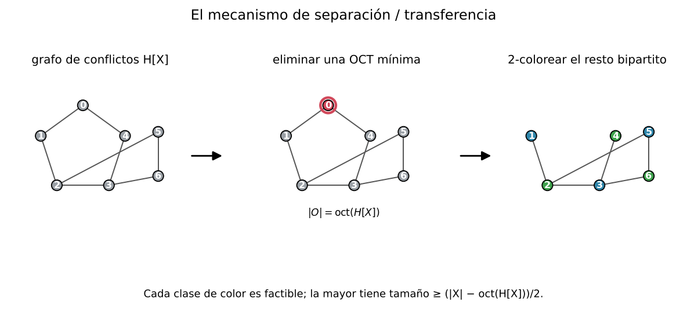
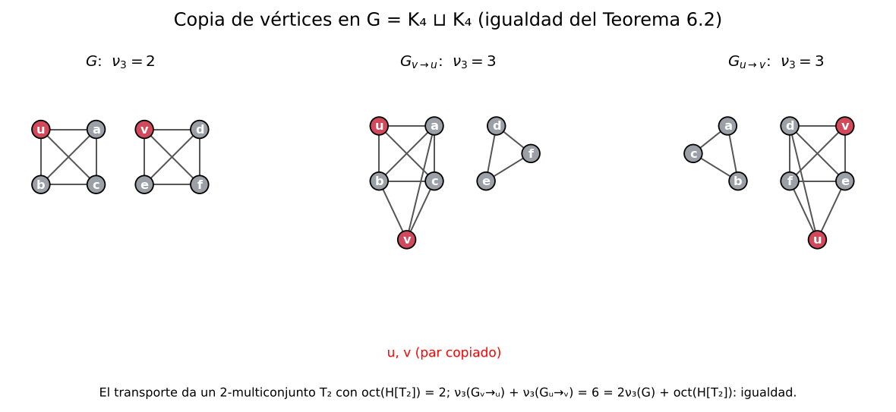
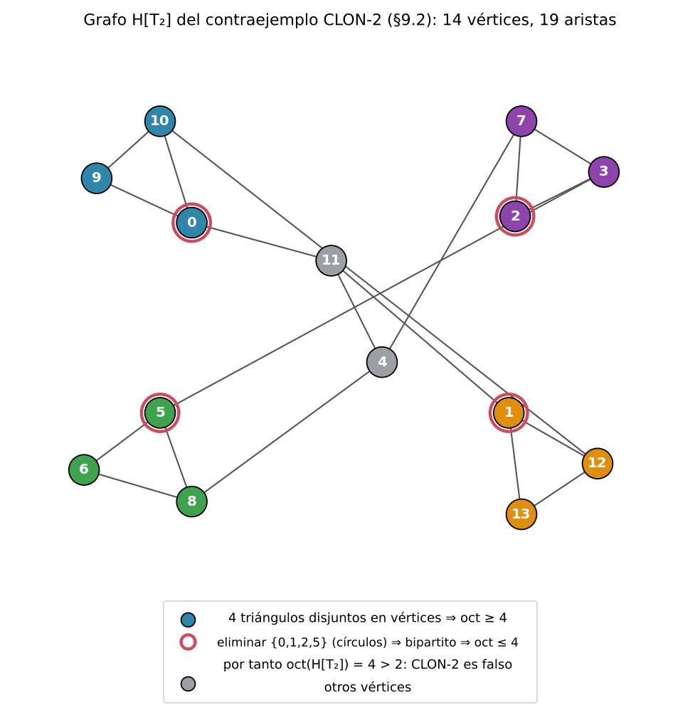

# Defectos de colorabilidad y realizabilidad en relajaciones de empaquetamiento dominadas por recursos

**Juan Pablo Traverso Gianini**  
Investigador independiente, Santiago, Chile  
[jtraverso@gmail.com](mailto:jtraverso@gmail.com)  
[ORCID: 0009-0003-6068-4096](https://orcid.org/0009-0003-6068-4096)

**Paper V de la serie — Preprint 1.0**  
**Fecha:** 18 de octubre de 2026  

**MSC 2020:** Principal 05C70; secundarias 05C15, 05C85, 90C27.

## Resumen

Un empaquetamiento fraccional describe cuánto puede utilizarse de cada objeto, pero un empaquetamiento entero debe resolver también los conflictos entre los objetos seleccionados. Estudiamos cotas finitas para la pérdida en este paso. Eliminar copias hasta que su grafo de conflictos sea \(q\)-coloreable da una cota de transferencia en términos del defecto de colorabilidad ponderado. Extendemos esta cota a clases que admiten realizaciones en un sistema objetivo ponderado fijo, permitiendo que los objetos realizadores difieran de las copias originales. La pérdida resultante es el peso eliminado más la suma de las pérdidas de realización. La coloración de aristas desde listas en grafos bipartitos proporciona realizadores exactos en anfitriones; en una familia \(K_{r,r}\), estos eliminan un defecto auxiliar de colorabilidad cuadrático. Las aplicaciones incluyen desigualdades enteras de copia de vértices, valores exactos de programas lineales para perfiles puros y certificación de empaquetamientos de cliques en anfitriones. La construcción SEAL combina regímenes exactos con mejora local y un certificado racional independiente de cota superior. Sus garantías distinguen la factibilidad, la exactitud bajo hipótesis estructurales y el error certificado de una salida concreta.

**Palabras clave:** empaquetamiento de triángulos; empaquetamiento fraccional; defecto de colorabilidad; defecto de realizabilidad; coloración de aristas desde listas; desigualdad de copia; certificados de empaquetamiento.

## 1. Introducción

Muchos problemas de empaquetamiento admiten una descripción fraccional útil antes de admitir una construcción entera útil. Una restricción de recursos puede acotar la carga total en cada arista o incidencia y, al mismo tiempo, dejar abierta la selección de objetos mutuamente compatibles. Consideramos una versión finita de este problema: dada una solución fraccional, o simplemente un multiconjunto de objetos candidatos, ¿cuánto valor debe perderse al producir un empaquetamiento factible?

Una respuesta procede de la coloración. Se forma un grafo cuyos vértices son las ocurrencias de los objetos y cuyas aristas representan los conflictos, incluidos los conflictos entre copias repetidas de un mismo objeto. Después de eliminar un conjunto que haga este grafo \(q\)-coloreable, una clase de color de tamaño máximo da un empaquetamiento factible. Para objetos ponderados, el mismo argumento selecciona una clase de peso máximo. Si el multiconjunto se obtuvo escalando una solución fraccional por \(q\), el peso eliminado dividido por \(q\) acota la pérdida. Esta observación elemental separa el paso de selección combinatoria de la elección de la solución fraccional.

### 1.1. De clases independientes a clases realizables

La independencia puede ser una exigencia más fuerte de lo que necesita una aplicación. Una clase de solicitudes puede admitir un empaquetamiento después de reasignar sus objetos a anfitriones adecuados. Exigir que la clase original sea independiente descartaría solicitudes que esa construcción podría conservar. Nuestra formulación principal registra el coste de realizar una clase en un sistema objetivo fijo.

Supongamos que las ocurrencias de un multiconjunto ponderado \(X\), fuera de un conjunto de eliminación \(Z\), se particionan en \(q\ge1\) clases \(C_1,\ldots,C_q\). Supongamos además que cada clase tiene una realización factible \(R(C_i)\) en el mismo sistema objetivo, con una pérdida de peso a lo sumo \(r(C_i)\). El Teorema 4.2 proporciona una clase cuya realización satisface
\[
|X|_w\le q\,w_{\mathsf T}(R(C_i))+w(Z)+\sum_{j=1}^q r(C_j).
\]
La demostración es un argumento de promedio. El trabajo sustantivo en una aplicación consiste en construir las realizaciones y controlar sus pérdidas. Cuando cada clase independiente se realiza a sí misma, el coste mínimo del certificado es exactamente el defecto de colorabilidad ponderado (Teorema 4.4).

Las asignaciones a anfitriones dan una separación concreta. Considérense las aristas de \(K_{r,r}\) como solicitudes, con \(r\) anfitriones disponibles para cada arista. Conservar solo una clase independiente en su grafo de líneas retiene a lo sumo \(r\) solicitudes. Una asignación propia de anfitriones realiza las \(r^2\) solicitudes como triángulos en anfitriones disjuntos en aristas. El Ejemplo 5.5 precisa esta comparación, incluido el sistema objetivo. El teorema de Galvin [18] y su extensión local de Borodin--Kostochka--Woodall [19] proporcionan criterios más generales de realización exacta.

### 1.2. Copias y construcciones certificadas

La operación de copia de vértices proporciona una segunda aplicación. Para vértices no adyacentes \(u,v\), sea \(G_{v\to u}\) el grafo que sustituye el vecindario de \(v\) por el de \(u\). Transportar de vuelta a \(G\) los empaquetamientos de triángulos de las dos copias opuestas produce un multiconjunto \(T_2\). Su grafo de conflictos mide la pérdida en la desigualdad entera
\[
\nu_3(G_{v\to u})+\nu_3(G_{u\to v})
\le 2\nu_3(G)+\operatorname{oct}(H[T_2]).
\]
El Teorema 6.2 demuestra esta afirmación para los empaquetamientos óptimos elegidos en las copias. La estructura adicional de sus conflictos transportados da la cota ajustada
\(\nu_3(G_{v\to u})+\nu_3(G_{u\to v})\le3\nu_3(G)\).
Los empaquetamientos mixtos de triángulos y \(K_4\) requieren una contabilidad de errores distinta, tratada en la Sección 7.

Para una construcción explícita, un certificado útil no necesita identificar de antemano un óptimo. El Corolario 4.6 separa la brecha entre valores primal y dual factibles del coste de realizar la solución primal escalada. La Sección 8 desarrolla después SEAL (*Schedule–Estimate–Audit–Lock*) para empaquetamientos de cliques en anfitriones. Utiliza construcciones exactas en los regímenes puros y bipartitos especificados, y mejoras locales en los demás casos. Una salida factible \(R\) y un valor dual racional válido \(U\) dan
\[
|R|\le\nu\le\lfloor U\rfloor.
\]
Este certificado sigue siendo válido con independencia de cómo la construcción haya encontrado \(R\).

### 1.3. Contexto y organización

Para grafos, el defecto de colorabilidad utilizado aquí es terminología establecida [15–17]; no se reivindica novedad para ese parámetro ni para su cálculo elemental de coloración. La presente formulación se refiere a su uso en la transferencia dominada por recursos, a su extensión a clases realizables y a las aplicaciones de copias y anfitriones. El paso de promedio es, por sí mismo, elemental.
En el modelo estándar de anfitriones, tomar copias disjuntas de las paletas de los
anfitriones y colorear cada arista local por su par subyacente da una formulación
restringida de emparejamiento arcoíris. Le--Pfender [29] estudian el grafo de líneas con
conflictos de color asociado y algoritmos generales de emparejamiento arcoíris.
Stamoulis [30] estudia la eliminación de clases de color completas para obtener grafos
de conflictos residuales con propiedades estructurales o de exactitud de relajaciones.
Ese parámetro de eliminación por grupos difiere de nuestra eliminación ponderada de
ocurrencias y del coste separado de realizar clases en un sistema objetivo fijo.
Utilizamos esos trabajos como contexto, no como una clasificación de dificultad del
modelo restringido de anfitriones ni como garantía de aproximación para la búsqueda
N1/N2 concreta que sigue. El uso de estructura fraccional en la reducción entera tiene un antecedente clásico en la teoría de Nemhauser--Trotter [9]. Haxell--Rödl [10] y Yuster [11] comparan asintóticamente empaquetamientos enteros y fraccionales, mientras que nuestras cotas conservan un error finito dependiente del certificado. El trabajo de Krivelevich [12] aporta contexto relacionado sobre empaquetamientos y cubrimientos de triángulos.

Wallis y Zhang [31, Proposición 3.2] establecieron una conexión exacta anterior entre particiones en cliques y un déficit de colorabilidad. Para un join con un conjunto independiente expresan el número de partición mediante el máximo orden total de una subfamilia coloreable de cliques del núcleo, descontando el coste de la partición del núcleo. Para particiones en aristas y triángulos en su marco subcúbico, su análisis separa además costes de triángulos y de eliminación. Es un antecedente concreto de la contabilidad de defectos mediante colorabilidad; este artículo estudia certificados ponderados de transferencia y realización en un sistema objetivo fijo, junto con las aplicaciones a copias y asignaciones a anfitriones.

El Paper IV [25] demuestra para todo orden la cota \(c_4(G)\le M(n)+b\) en grafos cordales, con una constante absoluta \(b\), y el máximo exacto \(M(n)=\lfloor n(n+1)/6\rfloor\) para todos los órdenes suficientemente grandes. Esto implica la cota \(n^2/6+O(n)\) planteada en el problema 81 de Erdős [14]; no afirma \(b=0\) en todos los órdenes. Okechukwu [32, Teorema 1.1 y Corolario 1.2] también demuestra la cota para todo orden salvo una constante aditiva y el valor extremal exacto eventual. Aquí no se reivindica prioridad para esas conclusiones extremales. El presente artículo estudia mecanismos generales de empaquetamiento y realización finitos, con los defectos de colorabilidad y realizabilidad como medidas de la pérdida entre representaciones.

Dentro de la serie Erdős #81 [13,14], los Papers I y II estudian funcionales fraccionales de empaquetamiento y cubrimiento de triángulos [2,4], y el Paper III demuestra un resultado con error lineal para grafos split [5]. El Paper V utiliza la operación de copia del Paper II y da una demostración, desde el lado del empaquetamiento, de su desigualdad de copia fraccional. La identidad \(\nu_3^*=\tau_3^*\) es dualidad finita de programación lineal. La afirmación entera de copia es la contribución de la sección sobre copias. En las demostraciones que siguen no se utiliza ningún teorema del Paper III ni ningún teorema de redondeo asintótico.

La nota de investigación IV–V que acompaña a este trabajo [24] da un ensamblaje separado, basado en certificados, de esa cota ya establecida de Erdős 81 mediante la transferencia de clases realizables. Completar un empaquetamiento físico de triángulos/\(K_4\) da \(c_4(G)\le e(G)-L+\rho\), donde \(L\) es la ganancia de referencia y \(\rho\) el coste normalizado del certificado. El redondeo mixto y los constructores casi extremales del Paper IV [25] proporcionan certificados que se ajustan al objetivo \(M(n)=\lfloor n(n+1)/6\rfloor\) para grafos cordales suficientemente grandes, con una corrección aditiva absoluta para los órdenes restantes. Esa aplicación conserva como resultado demostrado la localización estructural de IV; la desigualdad de transferencia no establece por sí sola el coste de realización requerido. Su demostración y su proyecto formal independiente se mantienen en la nota, en lugar de incorporarse al argumento principal de este trabajo.

Las Secciones 2–4 presentan las afirmaciones de transferencia y realización. La Sección 5 construye realizadores en anfitriones. Las Secciones 6–7 establecen las aplicaciones de copia y programación lineal; la Sección 8 presenta la construcción SEAL y sus certificados. La Sección 9 registra obstrucciones finitas a afirmaciones más fuertes. Las interfaces adicionales del cálculo estructural y de incidencias de recursos se enumeran en la Sección 6 del companion formal. El teorema abstracto de transferencia no proporciona por sí solo los resultados estructurales necesarios para la aplicación cordal de [24].

## 2. Sistemas de conflictos y relajaciones dominadas por recursos

**Definición 2.1 (sistema de conflictos).** Un *sistema de conflictos* es un par \((\mathcal O,K)\), donde \(\mathcal O\) es un conjunto finito de objetos y \(K\) es una relación simétrica e irreflexiva sobre objetos distintos. Una solución factible es un conjunto independiente \(S\subseteq\mathcal O\). Escribimos \(\nu(\mathcal O,K)\) para el tamaño máximo de una solución factible.

Entre los ejemplos se encuentran los empaquetamientos de triángulos disjuntos en aristas, las programaciones de cliques en anfitriones, los emparejamientos y las formulaciones de coloración de aristas desde listas.

**Definición 2.2 (multiconjunto de multiplicidad acotada y grafo de conflictos).** Sea \(X\) un multiconjunto sobre \(\mathcal O\). Su grafo de conflictos \(H[X]\) tiene un vértice por cada copia en \(X\). Dos vértices son adyacentes cuando sus objetos subyacentes están en conflicto; dos copias distintas del mismo objeto también son adyacentes. Si cada objeto tiene multiplicidad a lo sumo \(q\), entonces \(X\) se denomina un \(q\)-multiconjunto.

**Definición 2.3 (defecto de colorabilidad).** Para \(q\ge1\), sea \(D_q(H)\) el número mínimo de vértices cuya eliminación hace que \(H\) sea \(q\)-coloreable. Para \(q=2\),

\[
D_2(H)=\operatorname{oct}(H),
\]

el número de transversal de ciclos impares.

Para \(q=2\), \(D_2(H)\) es el defecto de colorabilidad de Dol'nikov [15]. Para \(q\) general, \(D_q(H)\) coincide con el defecto de \(q\)-colorabilidad \(\mathrm{cd}^q(H)\) de Kříž [16] (véase también Ziegler [17]) cuando \(H\) se considera un hipergrafo 2-uniforme. Conservamos la notación \(D_q\) para destacar su papel como defecto por eliminación de vértices en las cotas de transferencia. En particular, \(D_1(H)=|V(H)|-\alpha(H)\). No se reivindica novedad para el parámetro en sí ni para el cálculo elemental enumerado en la sección de resultados auxiliares del companion formal.

**Definición 2.4 (estructura de recursos y programa lineal de recursos).** Un sistema de conflictos tiene *estructura de recursos* si existe un conjunto finito \(\mathcal R\) y una aplicación \(\rho:\mathcal O\to 2^{\mathcal R}\) tales que dos objetos distintos están en conflicto si y solo si sus conjuntos de recursos se intersecan. El poliedro de capacidades de recursos es

\[
P_{\mathrm{res}}
=
\left\{
x\in\mathbb R_{\ge0}^{\mathcal O}:
\sum_{o:\,r\in\rho(o)}x_o\le1
\text{ para todo }r\in\mathcal R
\right\}.
\]

El programa lineal de recursos maximiza \(\sum_o x_o\) sobre \(P_{\mathrm{res}}\).

**Definición 2.5 (relajación dominada por recursos).** Un politopo \(P\subseteq\mathbb R_{\ge0}^{\mathcal O}\) es una *relajación dominada por recursos* si

\[
P\subseteq P_{\mathrm{res}}
\]

y sus puntos \(0/1\) son exactamente los indicadores de las soluciones factibles. Escribimos

\[
\mu^*(P):=\max_{x\in P}\sum_{o\in\mathcal O}x_o.
\]

Un óptimo \(x^*\in P\) es \(1/q\)-entero si \(x_o^*\in\{0,1/q,\ldots,1\}\) para todo \(o\). Cuando la región de capacidades de recursos es acotada, el propio programa lineal de recursos y cualquier refuerzo que conserve los puntos \(0/1\) factibles son dominados por recursos. Que cada objeto tenga un conjunto de recursos no vacío es suficiente para la acotación. Si se permiten conjuntos de recursos vacíos, añadir las cotas \(x_o\le1\) da una relajación acotada con los mismos puntos \(0/1\) factibles.

Las estructuras adicionales de incidencia de recursos se describen en la sección de resultados auxiliares del companion formal.

---

## 3. El lema de separación y los teoremas de transferencia

El grafo de conflictos separa el problema de selección de la relajación que lo produjo. En esta etapa no es necesario saber si el multiconjunto procede de un óptimo de programación lineal. El primer lema conserva dos clases factibles; las afirmaciones de transferencia aplican después esa selección a una solución fraccional escalada.

**Lema 3.1 (separación).** Para todo multiconjunto finito \(X\), existen soluciones factibles disjuntas \(S_1,S_2\subseteq X\) tales que

\[
|S_1|+|S_2|
\ge
|X|-\operatorname{oct}(H[X]).
\]

*Demostración.* Eliminamos una transversal óptima de ciclos impares \(O\), con \(|O|=\operatorname{oct}(H[X])\). El grafo \(H[X\setminus O]\) es bipartito; lo coloreamos propiamente con \(2\) colores. Cada clase de color es un conjunto independiente del sistema de conflictos y, por tanto, una solución factible. Sus tamaños suman \(|X|-|O|\). ∎

**Figura 1.** El lema de separación (Lema 3.1): eliminar una transversal mínima de ciclos impares, colorear con 2 colores el resto bipartito y tomar una clase de color; la mayor tiene tamaño \(\ge (|X|-\operatorname{oct}(H[X]))/2\).

**Corolario 3.2.** Para todo multiconjunto finito \(X\),

\[
\nu
\ge
\left\lceil
\frac{|X|-\operatorname{oct}(H[X])}{2}
\right\rceil.
\]

Los dos corolarios siguientes registran la cota inferior del lado del certificado y su caso de igualdad.

**Definición (multiconjunto de testigos privados).** Para un certificado del lado del cubrimiento \(C\), un multiconjunto de testigos privados \(X_C\) asigna exactamente un testigo privado a cada elemento de \(C\); en particular, \(|X_C|=|C|\).

**Corolario 3.2a (cota inferior de testigos privados).** Sea \(X_C\) un multiconjunto de testigos privados para un certificado del lado del cubrimiento \(C\), y sea \(H[X_C]\) su grafo de conflictos. Si \(\nu\) denota la mayor subfamilia factible, entonces para todo \(q\ge2\)

\[
|C|-q\nu\le D_q(H[X_C]).
\]

En particular, para \(C\) un cubrimiento mínimo de triángulos (por lo que \(|C|=\tau_3(G)\)) y \(q=2\), puesto que \(D_2=\operatorname{oct}\),

\[
\tau_3(G)-2\nu_3(G)\le \operatorname{oct}(H[X_C]).
\]

Aquí la mayor subfamilia factible de \(X_C\) tiene tamaño a lo sumo \(\nu_3(G)\), de modo que la desigualdad para triángulos se deduce de la cota general. Por tanto, un excedente del lado del cubrimiento sobre \(q\) clases enteras factibles obliga a un defecto real de colorabilidad en el grafo de conflictos.

*Demostración.* Eliminamos un conjunto óptimo de eliminación para \(D_q(H[X_C])\) y coloreamos propiamente con \(q\) colores el grafo de conflictos que sobrevive. Cada clase de color es factible, por lo que tiene tamaño a lo sumo \(\nu\). Por tanto,

\[
|C|-D_q(H[X_C])\le q\nu,
\]

lo que equivale a la desigualdad expuesta. Para \(q=2\), \(D_2=\operatorname{oct}\). ∎

**Corolario 3.2b (rigidez en la igualdad).** Con la notación del Corolario 3.2a, supongamos

\[
D_q(H[X_C])=|C|-q\nu.
\]

Entonces, para todo conjunto mínimo de eliminación \(O\) y toda \(q\)-coloración propia de \(H[X_C]-O\), las \(q\) clases de color tienen tamaño exactamente \(\nu\). Recíprocamente, si un conjunto mínimo de eliminación y una \(q\)-coloración propia dejan \(q\) clases factibles de tamaño \(\nu\), entonces se cumple la igualdad anterior.

Para \(q=2\), la igualdad
\[
\operatorname{oct}(H[X_C])=\tau_3(G)-2\nu_3(G)
\]
significa que eliminar una transversal mínima de ciclos impares deja dos empaquetamientos máximos de triángulos.

*Demostración.* Después de eliminar \(O\), los vértices que sobreviven se separan en \(q\) clases de color factibles \(S_1,\ldots,S_q\), cada una de tamaño a lo sumo \(\nu\). La igualdad da

\[
\sum_{i=1}^q |S_i|=|C|-|O|=q\nu.
\]

Como los \(q\) sumandos están acotados superiormente por \(\nu\), cada sumando es igual a \(\nu\). El recíproco es la misma identidad leída en sentido inverso. ∎

El escalamiento conecta la solución fraccional con el argumento de multiconjuntos. Las multiplicidades registran exactamente el valor fraccional, mientras que las restricciones de recursos controlan cuántas copias pueden utilizar un recurso. Son funciones distintas: contar las copias identifica el valor de referencia, y resolver sus conflictos produce la solución entera.

**Teorema 3.3 (transferencia semientera).** Sea \(P\) una relajación dominada por recursos y escribamos \(\mu^*=\mu^*(P)\). Supongamos que \(P\) tiene un óptimo semientero \(x^*\). Sea \(X\) el multiconjunto que contiene dos copias de cada objeto con \(x_o^*=1\) y una copia de cada objeto con \(x_o^*=1/2\). Entonces

\[
\mu^*-\nu
\le
\frac{\operatorname{oct}(H[X])}{2}.
\]

*Demostración.* Puesto que \(P\subseteq P_{\mathrm{res}}\), cada recurso tiene carga total escalada a lo sumo dos, y el multiconjunto construido satisface \(|X|=2\mu^*\). El Corolario 3.2 da

\[
\nu
\ge
\frac{2\mu^*-\operatorname{oct}(H[X])}{2}.
\]

Reordenar demuestra la afirmación. ∎

**Teorema 3.4 (transferencia \(q\)-entera).** Sea \(P\) una relajación dominada por recursos y escribamos \(\mu^*=\mu^*(P)\). Supongamos que \(P\) tiene un óptimo \(1/q\)-entero \(x^*\). Sea \(X\) el multiconjunto que contiene \(qx_o^*\) copias de cada objeto \(o\). Entonces

\[
\mu^*-\nu
\le
\frac{D_q(H[X])}{q}.
\]

*Demostración.* Cada restricción de recursos satisface

\[
\sum_{o:\,r\in\rho(o)}x_o^*\le1.
\]

Después de escalar por \(q\), a lo sumo \(q\) copias utilizan cualquier recurso fijo, y \(|X|=q\mu^*\). Eliminamos un conjunto mínimo que logra \(D_q(H[X])\) y coloreamos propiamente con \(q\) colores el grafo de conflictos restante. Cada clase de color contiene a lo sumo una copia de cada objeto y es factible. Por tanto, la clase mayor tiene tamaño al menos

\[
\frac{|X|-D_q(H[X])}{q}
=
\mu^*-\frac{D_q(H[X])}{q}.
\]

Su tamaño es a lo sumo \(\nu\), lo que da el resultado. ∎

Para \(q=2\), la \(2\)-colorabilidad equivale a ser bipartito y \(D_2(H)=\operatorname{oct}(H)\), de modo que el Teorema 3.4 se especializa en el Teorema 3.3.

**Observación (dónde interviene la estructura del programa lineal).** El argumento de coloración es una afirmación sobre el grafo de conflictos del multiconjunto escalado. La dominación por recursos y la \(1/q\)-integralidad se utilizan para construir ese multiconjunto a partir de un óptimo de programación lineal e identificar su tamaño como \(q\mu^*\); no son ingredientes adicionales del propio paso de coloración.

Para pesos distintos, la clase que se conserva es una de peso máximo, en lugar de una de tamaño máximo. El mismo argumento de promedio sigue siendo válido porque la eliminación y la selección se miden con los mismos pesos de los objetos. Esta forma ponderada no modifica el problema objetivo.

**Teorema 3.4w (transferencia ponderada).** Sea \((\mathcal O,K)\) un sistema de conflictos, sea \(w:\mathcal O\to\mathbb N\) un peso, sea \(q\ge1\) y sea \(X\) un multiconjunto de objetos. Escribimos

\[
|X|_w=\sum_o w(o)X(o),
\qquad
\nu_w=\max\Big\{\sum_{o\in S}w(o):S\text{ factible}\Big\},
\]

y sea \(D_q^w(H[X])\) el peso total mínimo de copias de un conjunto de vértices cuya eliminación hace que \(H[X]\) sea \(q\)-coloreable. Entonces

\[
|X|_w\le q\nu_w+D_q^w(H[X]).
\]

*Demostración.* Eliminamos un conjunto \(Z\) de peso mínimo y coloreamos el resto con \(q\) colores. La clase de color de peso máximo tiene peso al menos \((|X|_w-w(Z))/q\), contiene a lo sumo una copia de cada objeto y es factible. Por tanto, su peso es a lo sumo \(\nu_w\). Reordenar da la afirmación. ∎

Para \(w\equiv1\), esto da la desigualdad combinatoria que sustenta el Teorema 3.4. Cuando \(X\) se obtiene escalando un óptimo \(1/q\)-entero, la identidad adicional \(|X|=q\mu^*\) es el paso de contabilidad del programa lineal. La transferencia ponderada es útil cuando los objetos tienen valores distintos; las cotas para una clase particular de grafos requieren resultados estructurales adicionales.

**Variante con depuración.** A veces, un argumento de transferencia descarta primero toda copia que utiliza un conjunto designado de recursos malos. Si \(D\) es el conjunto resultante de objetos subyacentes, \(X_0\) es el multiconjunto residual y eliminar \(Z\) hace que \(H[X_0]\) sea \(q\)-coloreable, entonces el mismo argumento de conteo da

\[
 |X|_w\le q\nu_w+w(Z)+\sum_{o\in D}w(o)X(o).
\]

Por tanto, el término de defecto ordinario se aplica solo al multiconjunto residual, mientras que el peso descartado se registra explícitamente.

**Lema 3.5 (localización de paridad).** Sea \(X=A\sqcup B\). Todo ciclo impar de \(H[X]\) contiene un número impar de aristas internas a \(A\) o a \(B\). En consecuencia, eliminar un cubrimiento de vértices del subgrafo de aristas internas deja un grafo bipartito y, por tanto,

\[
\operatorname{oct}(H[X])
\le
\tau\!\left(E(H[X][A])\cup E(H[X][B])\right).
\]

*Demostración.* Un ciclo utiliza un número par de aristas que cruzan entre \(A\) y \(B\). Por ello, un ciclo impar utiliza un número impar de aristas internas. Eliminar un cubrimiento de vértices de todas las aristas internas deja solo aristas cruzadas, y el grafo restante es bipartito con partes \(A\) y \(B\). ∎

En la aplicación de copia que sigue, los conflictos internos en cada vértice central forman la unión de dos emparejamientos, de modo que el subgrafo de aristas internas es una unión de caminos y ciclos pares.

---

## 4. Defectos de realizabilidad y transferencia de clases realizables

El mecanismo de colorabilidad requiere una clase de color independiente para obtener un empaquetamiento factible. En las aplicaciones, una clase puede admitir, en cambio, una realización física directa. Esta sección hace explícita esa distinción.

**Definición 4.1 (realizador y certificado de realizabilidad).** Sea \(\mathcal C\) un sistema de conflictos de origen, sea \(X\) un multiconjunto finito de sus objetos y sea \(w:\mathcal O(\mathcal C)\to\mathbb N\) un peso. Sea \(\mathsf T\) un sistema de conflictos objetivo con peso objetivo \(w_{\mathsf T}:\mathcal O(\mathsf T)\to\mathbb N\). Un *realizador* de una clase \(S\subseteq V(H[X])\) es un conjunto factible \(R(S)\subseteq\mathcal O(\mathsf T)\), junto con una pérdida \(r(S)\in\mathbb N\), tal que

\[
w(S)\le w_{\mathsf T}(R(S))+r(S).
\]

En toda esta sección, el sistema de conflictos objetivo ponderado \((\mathsf T,w_{\mathsf T})\) es fijo y, por ello, se omite en la notación del defecto de realizabilidad.

Es *exacto* cuando \(r(S)=0\). Un certificado de realizabilidad consta de un conjunto de eliminación \(Z\), una partición \(V(H[X])\setminus Z=C_1\sqcup\cdots\sqcup C_q\) (cuyas clases no tienen por qué ser independientes) y realizadores de las clases. Su coste es \(w(Z)+\sum_i r(C_i)\).

Un certificado de realización registra dos pérdidas: el peso eliminado antes de formar las clases y la pérdida incurrida al realizar cada clase. Las realizaciones no tienen por qué ser compatibles entre sí. Solo se seleccionará una clase, de modo que lo relevante es que cada realización sea factible en el mismo sistema objetivo fijo.

**Teorema 4.2 (transferencia de clases realizables, RCT).** Para \(q\ge1\), todo certificado de realizabilidad tiene una clase \(C_i\) cuya realización satisface

\[
|X|_w\le q\,w_{\mathsf T}(R(C_i))+w(Z)+\sum_{j=1}^q r(C_j).
\]

En consecuencia,

\[
|X|_w\le q\,\nu_{w_{\mathsf T}}(\mathsf T)+w(Z)+\sum_{i=1}^q r(C_i).
\]

*Demostración.* El certificado particiona las copias fuera de \(Z\) y, por tanto,

\[
|X|_w=w(Z)+\sum_{j=1}^q w(C_j).
\]

Para cada clase, la desigualdad del realizador da \(w(C_j)\le w_{\mathsf T}(R(C_j))+r(C_j)\). Elegimos \(i\) para el que \(w_{\mathsf T}(R(C_i))\) sea máximo. Sumando las desigualdades de los realizadores se obtiene

\[
|X|_w-w(Z)-\sum_{j=1}^q r(C_j)
\le \sum_{j=1}^q w_{\mathsf T}(R(C_j))
\le q\,w_{\mathsf T}(R(C_i)),
\]

lo que constituye la primera afirmación. Como \(R(C_i)\) es factible en \(\mathsf T\), su peso es a lo sumo \(\nu_{w_{\mathsf T}}(\mathsf T)\), lo que da la segunda afirmación. ∎

Para realizadores exactos, la suma de pérdidas se anula.

**Definición 4.3 (defecto de realizabilidad).** Para \(q\ge1\) y una clase de admisibilidad \(\mathcal R\), escribimos \(D^w_{q,\mathcal R}(X)\) para el coste mínimo de un certificado de realizabilidad \(\mathcal R\)-admisible, cuando la clase de tales certificados es no vacía. En ese caso,

\[
|X|_w\le q\,\nu_{w_{\mathsf T}}(\mathsf T)+D^w_{q,\mathcal R}(X).
\]

Además, \(\mathcal R\subseteq\mathcal R'\) implica \(D^w_{q,\mathcal R'}(X)\le D^w_{q,\mathcal R}(X)\).

Como los costes son números naturales, toda clase no vacía de certificados tiene un coste mínimo.

Para una clase de admisibilidad general, la no vacuidad es una hipótesis efectiva. En la situación que contiene la identidad del Teorema 4.4, eliminar todas las copias proporciona un certificado admisible, por lo que el defecto es finito.

**Teorema 4.4 (el realizador identidad recupera el mecanismo de colorabilidad).** Para \(q\ge1\), si \(\mathsf T=\mathcal C\) y \(\mathcal R_{\mathrm{id}}\) consta de clases independientes realizadas por sus propios objetos con pérdida cero, entonces

\[
D^w_{q,\mathcal R_{\mathrm{id}}}(X)=D_q^w(H[X]).
\]

*Demostración.* Un conjunto de eliminación ponderado mínimo para \(D_q^w(H[X])\), seguido de una \(q\)-coloración del grafo de conflictos restante, da \(q\) clases independientes. Realizar cada clase por sus propios objetos da un certificado exacto de realizabilidad por la identidad con el mismo coste. Por tanto, \(D^w_{q,\mathcal R_{\mathrm{id}}}(X)\le D_q^w(H[X])\). Recíprocamente, las clases de todo certificado de realizabilidad por la identidad son independientes, de modo que forman una \(q\)-coloración después de retirar su conjunto de eliminación. Su coste es exactamente el peso eliminado y, por tanto, \(D_q^w(H[X])\le D^w_{q,\mathcal R_{\mathrm{id}}}(X)\). ∎

Así, RCT es exactamente el Teorema 3.4w para la clase de admisibilidad identidad, y toda clase de admisibilidad que contiene \(\mathcal R_{\mathrm{id}}\) tiene defecto a lo sumo \(D_q^w(H[X])\).

**Ejemplo 4.5 (una pérdida no vacua).** En la instancia \(K_{1,3}\) con pesos unitarios, \(q=1\) y dos listas completas de anfitriones, el defecto ordinario es \(D_1=2\), mientras que el defecto de realizabilidad en anfitriones es \(D_{1,\mathcal R_{\mathrm{host}}}=1\). Se elimina una base y las otras dos se sitúan en anfitriones distintos; ningún empaquetamiento puede contener más de dos triángulos porque cada triángulo utiliza un enlace de un anfitrión al centro.

---

### 4.6. Errores primal–dual y de realización

La cota siguiente separa también dos errores que pueden certificarse de forma independiente. Un par primal–dual mide cuánto puede distar del óptimo el valor fraccional de referencia. El certificado de realización mide la pérdida adicional necesaria para obtener un empaquetamiento físico. Mantener separados los errores permite un certificado entero útil incluso cuando la solución fraccional no era óptima.

La cota de transferencia puede utilizarse con una solución fraccional factible que no sea óptima. Para ello, consideramos un sistema finito de recursos en el que cada objeto utiliza un conjunto no vacío de recursos, con pesos racionales no negativos \(w(o)\). Escribimos \(g(P)=\sum_{o\in P}w(o)\), y sea \(W^*\) el máximo del programa lineal de recursos. La hipótesis de recursos no vacíos implica \(x_o\le1\), por lo que este programa lineal tiene un óptimo finito.

**Corolario 4.6 (certificación con dos errores).** Sea \(x\) racional y factible en el programa lineal de recursos, y sea \(y\in\mathbb Q_{\ge0}^{\mathcal R}\) tal que \(\sum_{e\in\rho(o)}y_e\ge w(o)\) para todo objeto. Pongamos
\[
L=\sum_o w(o)x_o,\qquad U=\sum_e y_e,
\qquad \ell_e(x)=\sum_{o:e\in\rho(o)}x_o.
\]
Sea \(q\ge1\) un entero tal que todo \(qx_o\) sea entero, y sea \(X\) el multiconjunto que contiene ese número de ocurrencias etiquetadas de \(o\). Supongamos que \(X\setminus Z=C_1\sqcup\cdots\sqcup C_q\) y que, para cada \(i\), hay un empaquetamiento factible \(P_i\) en este mismo sistema de recursos y un racional \(r_i\ge0\) con \(w(C_i)\le g(P_i)+r_i\). Definimos \(C_{\mathrm{real}}=w(Z)+\sum_i r_i\). Uno de los \(P_i\), denotado por \(P\), satisface
\[
g(P)\ge L-\frac{C_{\mathrm{real}}}{q},
\qquad
0\le W^*-g(P)\le U-L+\frac{C_{\mathrm{real}}}{q}.
\]
Además,
\[
U-L=\sum_e y_e(1-\ell_e(x))
 +\sum_o x_o\left(\sum_{e\in\rho(o)}y_e-w(o)\right).
\]

*Demostración.* Expandimos el lado derecho de la identidad. Las dos sumas de incidencias se cancelan y dejan \(U-L\). Cada término antes de la cancelación es no negativo. La misma identidad aplicada a cualquier punto primal factible demuestra \(W^*\le U\). Del lado de la realización,
\[
qL=w(Z)+\sum_i w(C_i)
\le C_{\mathrm{real}}+\sum_i g(P_i)
\le C_{\mathrm{real}}+q\max_i g(P_i).
\]
Elegimos un índice que maximice. El indicador de su empaquetamiento es primal factible y, por tanto, \(g(P)\le W^*\). Combinar las dos estimaciones da la afirmación. ∎

El corolario utiliza dualidad débil y el mismo argumento de promedio que el Teorema 4.2. Selecciona una realización; no requiere que la unión de las realizaciones sea factible. Para empaquetamientos mixtos de cliques con ganancia \(g(Q)=\binom{|Q|}{2}-1\), completar las aristas no cubiertas mediante bloques de una sola arista da una partición con a lo sumo \(e(G)-L+C_{\mathrm{real}}/q\) bloques. Un certificado dual mide la brecha de optimalidad restante, pero no es necesario para esta cota directa del número de bloques.

## 5. Realizadores estructurados en anfitriones

Describimos ahora una familia concreta de realizadores. Sea no vacío el conjunto de anfitriones \(H\). Una base \(e\) tiene extremos \(\operatorname{ends}(e)\) y una lista de anfitriones \(L(e)\subseteq H\). Situar \(e\) en \(h\in L(e)\) crea un triángulo que utiliza el recurso base \(e\) y los dos recursos de enlace \((h,x)\), para \(x\in\operatorname{ends}(e)\). Una asignación propia de anfitriones desde listas sobre un conjunto \(T\) elige \(c(e)\in L(e)\) y asigna anfitriones distintos a bases que comparten un extremo.

La regla de anfitriones se diseña a partir de los recursos reales de un triángulo. Las bases distintas protegen el recurso base, y la propiedad de asignación propia en cada extremo protege los recursos de enlace. Así, una coloración de solicitudes se convierte en un empaquetamiento solo después de comprobar ambos tipos de recursos.

**Proposición 5.1 (validez física).** Una asignación propia de anfitriones desde listas sobre \(T\) produce un empaquetamiento factible de todos los triángulos asociados en anfitriones. En consecuencia, una clase de bases distintas dos a dos que lleva tal asignación tiene un realizador exacto en anfitriones. El número de empaquetamiento objetivo es a lo sumo el número de bases.

**Teorema 5.2 (realización bipartita de aristas desde listas).** Sea \(B\) un grafo bipartito de solicitudes sobre un conjunto no vacío de anfitriones \(H\). Si cada lista de arista tiene tamaño al menos \(\Delta(B)\), entonces existe una asignación propia de anfitriones desde listas. El teorema local de Borodin--Kostochka--Woodall [19] da la misma conclusión cuando la lista de una arista \(uv\) tiene tamaño al menos \(\max(d_B(u),d_B(v))\). La afirmación global es el teorema de Galvin [18].

**Corolario 5.3 (completación en anfitriones y transferencia levantada).** Bajo cualquiera de los dos conjuntos de hipótesis del Teorema 5.2, en particular con un conjunto no vacío de anfitriones, cada base solicitada se realiza físicamente, de modo que \(|B|\le\nu(\mathrm{hostCS})\) para el sistema irrestricto de anfitriones. Si el sistema objetivo se restringe a las bases solicitadas —con objetos \((e,h)\) para \(e\in B\), denotado por \(\mathrm{hostCS}_B\)—, entonces

\[
\nu(\mathrm{hostCS}_B)=|B|.
\]

La cota superior en esta igualdad es incondicional, puesto que triángulos factibles distintos tienen bases distintas; la cota inferior la proporciona cualquier asignación propia desde listas. La igualdad para el sistema irrestricto se deduce cuando se solicitan todas las bases.

Si cada clase de una \(q\)-partición de \(X\setminus Z\) consta de bases distintas dos a dos y satisface las mismas hipótesis de listas de anfitriones, entonces

\[
|X|_w\le q\,\nu_w(\mathrm{hostCS})+w(Z),
\qquad
D_{q,\mathcal R_{\mathrm{host}}}^w(X)\le w(Z).
\]

Para la conclusión ponderada, el triángulo físico que realiza una base \(e\) hereda su peso: \(w_{\mathrm{host}}(h,e):=w(e)\). Por tanto, la realización conserva el peso y no solamente la cardinalidad.

**Ejemplo 5.5 (separación estricta).** Para \(K_{r,r}\) con \(r\ge2\), pesos unitarios, \(q=1\) y \(r\) anfitriones, el grafo auxiliar de conflictos es el grafo de líneas de \(K_{r,r}\). Así,

\[
D_1=r^2-r,
\qquad
D_{1,\mathcal R_{\mathrm{host}}}=0,
\qquad
\nu(\mathrm{hostCS})=r^2.
\]

La regla explícita de anfitriones \(c(u,j)=u+j\pmod r\) realiza todas las bases. Aquí se solicita cada base, por lo que este es el caso de todas las bases del Corolario 5.3.

*Demostración.* Para \(q=1\), el defecto ordinario es
\[
D_1(L(K_{r,r}))=|E(K_{r,r})|-\alpha(L(K_{r,r}))=r^2-r,
\]
porque los conjuntos independientes del grafo de líneas son emparejamientos y un emparejamiento máximo de \(K_{r,r}\) tiene tamaño \(r\). La asignación \(c(u,j)=u+j\pmod r\) da anfitriones distintos a bases que comparten cualquiera de sus extremos, por lo que realiza las \(r^2\) bases y tiene defecto de realizabilidad cero. Un empaquetamiento factible en anfitriones contiene a lo sumo un triángulo por base; por tanto, la asignación expuesta demuestra también \(\nu(\mathrm{hostCS})=r^2\). ∎

Esta es una separación estricta entre la codificación mediante clases independientes y la codificación mediante realizaciones físicas en anfitriones; no es una comparación de dos parámetros de eliminación sobre un mismo sistema de conflictos objetivo fijo.

El alcance es deliberadamente más limitado que el de una afirmación genérica de empaquetamiento físico. Galvin y el marco de realizabilidad no sustituyen un argumento de estabilidad cordal, no hacen pequeño el defecto de un óptimo fraccional arbitrario y no identifican el conflicto auxiliar con el conflicto físico. Proporcionan la implicación en una sola dirección que se necesita aquí: un certificado con realizadores da un empaquetamiento.

---

## 6. Desigualdades de copia y aplicación a cliques en anfitriones

### 6.1 Desigualdades de copia

La operación de copia crea dos grafos distintos, pero el argumento de transferencia debe terminar en el grafo original. Por ello, transportamos de vuelta ambos empaquetamientos antes de compararlos. El multiconjunto resultante conserva sus valores y registra los nuevos conflictos; la estimación de carga de aristas que sigue explica por qué estas ocurrencias transportadas proporcionan también un promedio fraccional factible.

Sea \(G\) un grafo y sean \(u,v\) no adyacentes. Escribimos \(G_{v\to u}\) y \(G_{u\to v}\) para los grafos de copia de vértices introducidos en el Paper II [4]: \(G_{v\to u}\) elimina todas las aristas incidentes con \(v\) y une \(v\) con \(N_G(u)\), y simétricamente para \(G_{u\to v}\).

Definimos una aplicación total \(\varphi'\) sobre los triángulos de \(G_{v\to u}\). Un triángulo \((v,x,y)\) se envía a \((u,x,y)\), mientras que un triángulo que no contiene a \(v\) se conserva sin cambios. Definimos \(\varphi''\) simétricamente sobre los triángulos de \(G_{u\to v}\). Para empaquetamientos \(P'\) y \(P''\) en los dos grafos copiados, ponemos

\[
T_2:=\varphi'(P')\uplus\varphi''(P'').
\]

Así, \(T_2\) es un multiconjunto de triángulos de \(G\).

La siguiente observación de carga se utiliza para estimar el tamaño del defecto OCT que aparece en el Teorema 6.2, tal como se aplica a la instancia CLON-2 de §9.2.

**Afirmación auxiliar 6.1a (cota de carga de aristas transportadas).** Para cualesquiera empaquetamientos enteros \(P'\) y \(P''\), cada arista de \(G\) tiene carga total a lo sumo dos en \(T_2\).

*Demostración.* La arista \(uv\) tiene carga cero. Para \(x\notin\{u,v\}\), la familia \(\varphi''(P'')\) aporta cero a \(ux\). La familia \(\varphi'(P')\) puede aportar a lo sumo una imagen de un triángulo en \(v\) que pasa por \(x\), puesto que esos triángulos comparten \(vx\), y a lo sumo un triángulo superviviente en \(u\) que pasa por \(x\), puesto que esos triángulos comparten \(ux\). Por tanto, la carga en \(ux\) es a lo sumo dos. La afirmación correspondiente para \(vx\) es simétrica. Finalmente, si \(a,b\notin\{u,v\}\), cada familia transportada aporta a lo sumo un triángulo que utiliza \(ab\). Así, toda arista tiene carga a lo sumo dos. ∎

**Teorema 6.1 (desigualdad de copia fraccional; reformulación del Paper II).** Para \(u,v\) no adyacentes,

\[
\nu_3^*(G_{v\to u})+\nu_3^*(G_{u\to v})
\le
2\nu_3^*(G).
\]

Por \(\nu_3^*=\tau_3^*\), esta es la desigualdad de cubrimientos copiados del Paper II [4], expresada en notación de empaquetamiento. La traducción utiliza \(|E(G_{v\to u})|+|E(G_{u\to v})|=2|E(G)|\): cada copia elimina las \(d(v)\) aristas en \(v\) y añade las \(d(u)\) aristas desde \(v\) hasta \(N_G(u)\), o a la inversa, y \(u,v\) no son adyacentes. Incluimos la demostración siguiente porque el resto del trabajo utiliza la afirmación del lado del empaquetamiento, en lugar de su equivalente del lado del cubrimiento.

*Demostración.* Sean \(w'\) y \(w''\) empaquetamientos fraccionales óptimos en los dos grafos copiados y transportémoslos mediante \(\varphi'\) y \(\varphi''\). Consideremos una arista \(ux\), donde \(x\notin\{u,v\}\). La segunda familia transportada aporta cero a \(ux\). En la primera familia, el peso total de los triángulos transportados en \(v\) que pasan por \(x\) es a lo sumo la carga en \(vx\) en \(w'\) y, por tanto, a lo sumo uno; el peso total de los triángulos supervivientes en \(u\) que pasan por \(x\) es a lo sumo la carga en \(ux\) en \(w'\) y, por tanto, a lo sumo uno. En consecuencia, la carga transportada conjunta en \(ux\) es a lo sumo dos. El mismo argumento se aplica a \(vx\). Para una arista \(ab\) con \(a,b\notin\{u,v\}\), cada familia transportada aporta a lo sumo uno, de modo que el total vuelve a ser a lo sumo dos; \(uv\) no recibe carga. Dividir entre dos la suma de las dos soluciones transportadas da un empaquetamiento fraccional factible de \(G\) con valor

\[
\frac{\nu_3^*(G_{v\to u})+\nu_3^*(G_{u\to v})}{2}.
\]

De ello se deduce la desigualdad. ∎

**Teorema 6.2 (desigualdad de copia entera).** Para empaquetamientos óptimos \(P'\) y \(P''\),

\[
\nu_3(G_{v\to u})+\nu_3(G_{u\to v})
\le
2\nu_3(G)+\operatorname{oct}(H[T_2]).
\]

La desigualdad subyacente de multiconjuntos vale para cualquier par de empaquetamientos factibles; la optimalidad se utiliza solo para identificar el lado izquierdo con los dos números de empaquetamiento entero. El multiconjunto \(T_2\) y, por tanto, el defecto OCT expuesto, son relativos al par elegido \(P',P''\).

*Demostración.* Toda imagen mediante \(\varphi'\) o \(\varphi''\) es un triángulo de \(G\), y

\[
|T_2|=|P'|+|P''|.
\]

Aplicamos el Lema 3.1 al sistema de conflictos de triángulos de \(G\) y al multiconjunto finito \(T_2\). Después de eliminar una transversal óptima de ciclos impares, las dos clases de color son empaquetamientos de triángulos en \(G\), porque la independencia en el grafo de conflictos es exactamente la disjunción en aristas. Por tanto,

\[
2\nu_3(G)
\ge
|T_2|-\operatorname{oct}(H[T_2]).
\]

Sustituir \(|T_2|=\nu_3(G_{v\to u})+\nu_3(G_{u\to v})\) da el resultado. Así, el Teorema 6.2 es el principio de separación aplicado al sistema de conflictos de triángulos. La cota de carga de aristas transportadas no es necesaria para la validez de la desigualdad entera; se utiliza solo para estimar el tamaño del defecto OCT, como en la Sección 9.2. ∎

**Ajuste de la cota.** Sea \(G=K_4\sqcup K_4\), con \(u\) y \(v\) en componentes distintas. Entonces

\[
\nu_3(G)=2,
\qquad
\nu_3(G_{v\to u})=\nu_3(G_{u\to v})=3,
\]

y se obtiene \(\operatorname{oct}(H[T_2])=2\). Por tanto, se alcanza la igualdad en el Teorema 6.2.

**Figura 2.** La operación de copia de vértices en la instancia que alcanza la igualdad \(G=K_4\sqcup K_4\) (Teorema 6.2): \(\nu_3(G)=2\), \(\nu_3(G_{v\to u})=\nu_3(G_{u\to v})=3\), \(\operatorname{oct}(H[T_2])=2\), por lo que se cumple la igualdad.

**Lema 6.2k (los sistemas de triángulos de carga 2 se sitúan en \(K_4\) físicos).** Sean \(t_1,t_2,t_3\) triángulos distintos de \(G\) que comparten una arista dos a dos, y supongamos que ninguna arista está en los tres. Entonces \(t_3\subseteq t_1\cup t_2\), \(|t_1\cup t_2|=4\) y \(t_1\cup t_2\) induce un \(K_4\) en \(G\). En consecuencia, cualquier familia de triángulos que comparten aristas dos a dos y tiene carga de aristas a lo sumo dos tiene a lo sumo cuatro miembros, y todo clique de tamaño al menos tres en el grafo de conflictos de triángulos de un multiconjunto de carga 2 tiene tamaño tres o cuatro y está soportado sobre un \(K_4\) físico.

*Demostración.* Si \(x\in t_3\setminus(t_1\cup t_2)\), entonces los dos subconjuntos de tamaño 2 \(t_1\cap t_3\) y \(t_2\cap t_3\) de \(t_3\setminus\{x\}\) coinciden, situando una arista en los tres triángulos. Por tanto, \(t_3\subseteq t_1\cup t_2\). Puesto que triángulos distintos que comparten una arista tienen una unión de cuatro vértices, \(t_3\) omite uno de esos cuatro vértices. Debe contener los dos vértices privados de \(t_1,t_2\), de modo que esos vértices son adyacentes; los cinco pares restantes ya pertenecen a \(t_1\cup t_2\). Así, la unión es un \(K_4\). La conclusión de cardinalidad se deduce porque todos esos triángulos son subconjuntos de tamaño 3 de este conjunto de cuatro vértices. ∎

**Corolario 6.2a (cota triple de copia).** Para \(u,v\) no adyacentes,

\[
\nu_3(G_{v\to u})+\nu_3(G_{u\to v})\ \le\ 3\,\nu_3(G),
\]

y se alcanza la igualdad en \(G=K_4\sqcup K_4\).

*Demostración.* Por la cota de carga de aristas transportadas (Afirmación 6.1a), cada arista de \(G\) tiene carga total a lo sumo dos en \(T_2\); por tanto, el grafo de conflictos de copias \(H[T_2]\) es *subcúbico* (una copia de un triángulo \(t\) encuentra a lo sumo su copia gemela y, por cada arista de \(t\), a lo sumo \(\mathrm{load}-1\) copias adicionales en conflicto, lo que da grado \(\le 5-2\,\mathrm{mult}(t)\le 3\)). Además, es *libre de* \(K_4\): cuatro copias que formasen un \(K_4\) serían cuatro triángulos distintos que comparten una arista dos a dos y, por tanto —excluida una arista común, que tendría carga \(\ge 4\), imposible—, las cuatro caras de un \(K_4\subseteq G\); ese \(K_4\) no puede contener a \(u\) (sus tres caras en \(u\) proceden solo de \(\varphi'(P')\) y sus preimágenes disjuntas en aristas necesitarían formas \(u\)/\(v\) distintas dos a dos, es decir, una \(2\)-coloración propia de \(K_3\)), ni a \(v\) por simetría, ni a ambos (pues \(u,v\) no son adyacentes), ni a ninguno (dos familias disjuntas en aristas proporcionan a lo sumo dos de las cuatro caras). La consecuencia del teorema de Brooks [28] utilizada aquí proporciona una \(3\)-coloración de un grafo subcúbico libre de \(K_4\), de modo que eliminar una clase de color de tamaño mínimo deja un grafo bipartito y \(\operatorname{oct}(H[T_2])\le\lfloor|T_2|/3\rfloor\). Escribiendo \(S:=\nu_3(G_{v\to u})+\nu_3(G_{u\to v})=|T_2|\), el Teorema 6.2 da \(S\le 2\nu_3(G)+\lfloor S/3\rfloor\), de donde \(S\le 3\,\nu_3(G)\). La instancia que alcanza la igualdad del Teorema 6.2 alcanza \(3+3=3\cdot 2\). ∎

### 6.2 El modelo de cliques en anfitriones

Una instancia de cliques en anfitriones tiene objetos \((j,e)\), donde \(j\) es un anfitrión y \(e=\{a,b\}\subseteq N_j\). Sus recursos son los pares globales \(e\) y las incidencias anfitrión–vértice \((j,a)\), \((j,b)\). Dos asignaciones están en conflicto precisamente cuando comparten uno de estos recursos.

El programa lineal de recursos impone restricciones de capacidad de pares y de grado por anfitrión. El *programa lineal maestro de emparejamientos* requiere además que el vector asociado con cada anfitrión \(j\) pertenezca al politopo de emparejamientos \(P_{\mathrm{mat}}(K_{N_j})\), utilizando la caracterización de Edmonds del politopo de emparejamientos [1]. Por tanto,

\[
P_{\mathrm{mat}}\subseteq P_{\mathrm{res}},
\]

y la inclusión puede ser estricta. Ambas relajaciones son dominadas por recursos. Escribimos \(\mu^*_{\mathrm{res}}\) y \(\mu^*_{\mathrm{mat}}\) cuando la distinción es relevante.

Sea \(\nu\) el óptimo entero. La *deficiencia* es

\[
k:=|\operatorname{cov}|-\nu,
\]

donde \(\operatorname{cov}\) es el conjunto de pares cubribles. Para cualquier conjunto \(F\) de pares, definimos \(\alpha'(F)\) como el número máximo de pares de \(F\) disjuntos en vértices dos a dos. Para un empaquetamiento máximo \(R\), sea \(F_R\subseteq\operatorname{cov}\) el conjunto de pares cubribles que \(R\) deja sin cubrir, y definimos

\[
\beta:=\max\{\alpha'(F_R): R\text{ es un empaquetamiento máximo}\}.
\]

Estos parámetros aparecen solo en los contraejemplos de la Sección 9.

## 7. Herramientas de programación lineal para cliques en anfitriones y refinamientos finitos de certificados

### 7.1 Perfiles puros y programa lineal de emparejamientos

Una paleta común hace que el problema de anfitriones tenga suficiente simetría para resolverlo exactamente. La cota superior procede de la capacidad de un anfitrión y del número de pares disponibles. La construcción alcanza esa cota asignando emparejamientos de una factorización a los anfitriones. La distinción entre el programa lineal de emparejamientos y el programa lineal de recursos basado solo en grados sigue siendo esencial, en particular para paletas impares.

**Proposición 7.1 (perfil puro).** Supongamos que los \(m\) anfitriones tienen la misma paleta \(N\), con \(|N|=s\ge2\). Entonces

\[
\nu
=
\mu^*_{\mathrm{mat}}
=
\min\left\{
m\left\lfloor\frac{s}{2}\right\rfloor,
\binom{s}{2}
\right\}.
\]

*Demostración.* Para todo anfitrión \(j\), un emparejamiento entero tiene tamaño a lo sumo \(\lfloor s/2\rfloor\). La misma cota se cumple en todo \(P_{\mathrm{mat}}(K_N)\): las restricciones de grado dan \(s/2\), y para \(s\) impar la desigualdad de conjuntos impares sobre \(N\) da \((s-1)/2\). Por tanto,

\[
\mu^*_{\mathrm{mat}}
\le
m\left\lfloor\frac{s}{2}\right\rfloor.
\]

Las capacidades de pares dan también \(\mu^*_{\mathrm{mat}}\le\binom{s}{2}\).

Las aristas de \(K_s\) se descomponen en \(\chi'(K_s)\) emparejamientos, cada uno de tamaño \(\lfloor s/2\rfloor\): una \(1\)-factorización cuando \(s\) es par y una casi \(1\)-factorización por turnos cuando \(s\) es impar. Además,

\[
\chi'(K_s)\left\lfloor\frac{s}{2}\right\rfloor
=
\binom{s}{2}.
\]

Si \(m\le\chi'(K_s)\), asignamos \(m\) emparejamientos distintos de la factorización a los anfitriones. En caso contrario, asignamos todos los emparejamientos de la factorización a anfitriones distintos. Estas construcciones alcanzan la menor de las dos cotas superiores. ∎

**Observación (por qué el programa lineal maestro es esencial).** Cuando \(s\) es impar, la desigualdad de conjuntos impares sobre toda la paleta es precisamente lo que impone la cota \(\lfloor s/2\rfloor=(s-1)/2\) en cada anfitrión. El programa lineal de recursos basado solo en grados permite un peso total por anfitrión de \(s/2\) y puede, por ello, superar el valor entero. Por tanto, la Proposición 7.1 es una afirmación sobre \(\mu^*_{\mathrm{mat}}\), no sobre \(\mu^*_{\mathrm{res}}\).

La proposición siguiente da la comparación global para la familia de perfiles puros. Se refiere al programa lineal de recursos basado solo en grados \(\mu^*_{\mathrm{res}}\), no al programa lineal maestro de emparejamientos.

**Proposición 7.1a (brecha global de recursos para perfiles puros).** Para todo perfil puro con \(m\) anfitriones y tamaño de paleta común \(s\ge1\),
\[
\nu(m,s)\ge\frac{s-1}{s}\,\mu^*_{\mathrm{res}}(m,s).
\]
En consecuencia, el factor es al menos \(2/3\) para \(s\ge3\), y \(\nu(m,2)=\mu^*_{\mathrm{res}}(m,2)\). En \((m,s)=(1,3)\), los valores son \(\nu=1\) y \(\mu^*_{\mathrm{res}}=3/2\).

*Demostración.* Sumar las restricciones de grado sobre anfitriones y vértices y, por separado, sumar las capacidades de pares da
\[
\mu^*_{\mathrm{res}}(m,s)\le\min\{ms/2,\tbinom{s}{2}\}.
\]
Para \(s\ge2\), aplicamos la Proposición 7.1 y \(m\lfloor s/2\rfloor\ge((s-1)/s)(ms/2)\). El caso \(s=1\) es vacío. La asignación semientera uniforme demuestra el valor fraccional del ejemplo del triángulo; su empaquetamiento entero tiene tamaño uno. ∎

**Proposición 7.1b (valor exacto de recursos y paridad).** Para \(m\ge1\) y \(s\ge2\),
\[
\mu^*_{\mathrm{res}}(m,s)=\min\{ms/2,\tbinom{s}{2}\}.
\]
Para \(s\) par, \(\nu(m,s)=\mu^*_{\mathrm{res}}(m,s)\). Para \(s\ge3\) impar y \(1\le m\le s-1\),
\[
\nu(m,s)=\frac{s-1}{s}\,\mu^*_{\mathrm{res}}(m,s).
\]

*Demostración.* La cota superior se estableció antes. Si \(m\le s-1\), asignamos peso \(1/(s-1)\) a cada par en cada anfitrión. Cada carga anfitrión–vértice es uno y cada carga de par es \(m/(s-1)\le1\), lo que da valor \(ms/2\). Si \(m\ge s-1\), asignamos en cambio peso \(1/m\). Cada carga de par es uno y cada carga anfitrión–vértice es \((s-1)/m\le1\), lo que da valor \(\binom{s}{2}\). Estas construcciones alcanzan la cota superior. Las afirmaciones de paridad se deducen por comparación con la fórmula entera de la Proposición 7.1. ∎

Así, toda paleta impar tiene instancias que alcanzan el factor de la Proposición 7.1a. Las paletas pares no tienen brecha del programa lineal de recursos. El programa lineal maestro de emparejamientos sigue siendo exacto para todos los perfiles puros por la Proposición 7.1; la pérdida de paridad concierne a la relajación basada solo en grados.

### 7.2 Certificación a posteriori

Construcción y certificación responden aquí a preguntas distintas. Un empaquetamiento factible proporciona una cota inferior con independencia de cómo se haya encontrado. Una cota superior comprobada por separado mide después la incertidumbre restante y demuestra la optimalidad cuando ambas coinciden. El certificado no requiere afirmar que el procedimiento de búsqueda sea globalmente óptimo.

El certificado siguiente es independiente de cómo se produzca el empaquetamiento \(R\); en particular, no depende de ninguna propiedad de optimalidad de SEAL.

Sea \(R\) cualquier empaquetamiento factible de cliques en anfitriones. Puesto que el programa lineal maestro de emparejamientos es una relajación,

\[
|R|
\le
\nu
\le
\left\lfloor\mu^*_{\mathrm{mat}}\right\rfloor.
\]

Por tanto,

\[
\widehat\beta_{\mathrm{LP}}
:=
\left\lfloor\mu^*_{\mathrm{mat}}\right\rfloor-|R|
\]

satisface

\[
0\le\nu-|R|\le\widehat\beta_{\mathrm{LP}}.
\]

En particular, \(\widehat\beta_{\mathrm{LP}}=0\) certifica que \(R\) es máximo.

Un certificado independiente del solver puede proporcionar, en cambio, un valor racional dual factible \(U\). La dualidad débil da

\[
\nu
\le
\mu^*_{\mathrm{mat}}
\le
U,
\qquad
\nu\le\lfloor U\rfloor.
\]

Por tanto, \(|R|=\lfloor U\rfloor\) certifica la optimalidad. El programa lineal maestro de emparejamientos tiene exponencialmente muchas desigualdades de blossom, pero puede optimizarse en tiempo polinómico mediante separación sobre el politopo de emparejamientos y el método del elipsoide [6,8]. Esto no afirma que tenga una formulación extendida general compacta; el politopo de emparejamientos tiene complejidad de extensión exponencial [7].

### 7.3 Copias mixtas y refinamientos finitos de certificados

La construcción de copia tiene también una forma mixta \(\{K_3,K_4\}\). Sean \(W\) y \(W^*\) los valores entero y fraccional del problema de empaquetamiento ponderado correspondiente, con ganancias enteras no negativas especificadas por el orden del clique. Las dos desigualdades siguientes se enuncian solo para ese sistema mixto.

**Teorema 7.3 (desigualdades de copia mixta).** Para \(u,v\) no adyacentes,

\[
W^*(G_{u\to v})+W^*(G_{v\to u})\le 2W^*(G),
\]

y

\[
W(G_{u\to v})+W(G_{v\to u})
\le 2W(G)+D_2^w(H[X]).
\]

Aquí \(X\) es el multiconjunto transportado en el sistema mixto de conflictos y \(D_2^w\) es su defecto de colorabilidad ponderado. Estas afirmaciones no establecen la estructura subcúbica o libre de \(K_4\) disponible en el contexto puramente triangular.

*Demostración del Teorema 7.3.* Utilizamos las dos aplicaciones totales de copia como en la Sección 6, ahora sobre las familias mixtas de cliques. La no adyacencia asegura que cada imagen siga siendo un clique del mismo orden, por lo que su ganancia prescrita no cambia. El argumento de carga de aristas del Teorema 6.1 se aplica a estas familias ponderadas: la suma de los dos empaquetamientos fraccionales transportados tiene carga a lo sumo dos en cada arista. Dividir entre dos demuestra la desigualdad fraccional. Transportar empaquetamientos enteros óptimos conserva su ganancia total como multiconjunto. La desigualdad de transferencia ponderada, Teorema 3.4w con \(q=2\), demuestra la afirmación entera. ∎

**Corolario 7.3a (copias mixtas con una cota de brecha de redondeo).** Sean \(u,v\) vértices no adyacentes de \(G\), y supongamos que los valores de empaquetamiento mixto satisfacen \(W^*(G)\le W(G)+B\). Entonces
\[
W(G_{u\to v})+W(G_{v\to u})\le2W(G)+2B.
\]
En particular, \(B=0\) da una desigualdad entera exacta.

*Demostración.* Un empaquetamiento entero es un empaquetamiento fraccional factible. Por tanto, el Teorema 7.3 da
\[
W(G_{u\to v})+W(G_{v\to u})
\le W^*(G_{u\to v})+W^*(G_{v\to u})
\le2W^*(G)\le2W(G)+2B.
\]
Esto demuestra la afirmación. ∎

El corolario deja la cota \(B\) como dato explícito. Una cota asintótica o estructural de esa brecha requiere un teorema separado con hipótesis y objetivo concordantes.

## 8. SEAL: construcción y certificación

El problema general de cliques en anfitriones se trata como un régimen heurístico: la revisión bibliográfica actual no identifica ni un algoritmo exacto de tiempo polinómico ni una demostración de dificultad computacional para esta formulación restringida. Por ello, SEAL (*Schedule–Estimate–Audit–Lock*) tiene dos funciones. En una componente bipartita de pares cubribles que satisface las condiciones de listas de la Sección 5, utiliza una construcción exacta respaldada por un teorema. En las componentes restantes, utiliza una programación guiada por escasez seguida de reparaciones locales estrictamente mejorantes. La auditoría es independiente de la construcción: o bien reconoce el certificado elemental (u=0), o bien proporciona una cota superior dual racional exacta.

La construcción calcula primero los pares cubribles e identifica los regímenes de perfiles puros y bipartitos. Un perfil puro se programa mediante la Proposición 7.1. En una componente bipartita que satisface el Teorema 5.2, una asignación propia desde listas programa cada par solicitado. En las componentes restantes, la construcción elige repetidamente un par con el menor número de anfitriones compatibles restantes y lo asigna a un anfitrión compatible de capacidad residual mínima, manteniendo un emparejamiento en cada anfitrión.

Después de la construcción, sea \(u=|\operatorname{cov}|-|R|\). Si \(u=0\), se han programado todos los pares cubribles y la salida es óptima. Un certificado dual racional, cuando está disponible, da un segundo criterio de parada: \(|R|=\lfloor U\rfloor\). En caso contrario, el procedimiento busca en los vecindarios N1 y N2 de profundidad fija que se describen a continuación, acepta solo mejoras estrictas y comprueba de nuevo el criterio combinatorio de parada. Se detiene cuando ninguno de los vecindarios contiene una mejora. La salida final incluye el intervalo certificado de la Sección 7.2 siempre que se disponga de un certificado dual. El companion proporciona el pseudocódigo y distingue la auditoría opcional del programa lineal del bucle de construcción.

Los movimientos de reparación se definen respecto de un empaquetamiento factible \(R\), un par cubrible no cubierto \(e=\{a,b\}\) y un anfitrión \(j\) con \(e\subseteq N_j\).

**N1 (reubicar–insertar).** Supongamos que \((j,f)\in R\), \(f\cap e\ne\varnothing\) y existe un anfitrión \(j'\ne j\) tal que \(f\subseteq N_{j'}\) y ambos extremos de \(f\) están sin emparejar en \(R_{j'}\). Sustituimos \((j,f)\) por \((j',f)\). Si ambos extremos de \(e\) quedan entonces sin emparejar en \(R_j\), añadimos \((j,e)\). La reubicación y la inserción forman un único intercambio propuesto: se aceptan juntas solo si la inserción es factible y aumenta \(|R|\); en caso contrario, \(R\) queda sin cambios.

**N2 (rotación en dos pasos).** Como en N1, salvo que mover \((j,f)\) a \(j'\) requiere primero mover una asignación \((j',g)\) a un anfitrión \(j''\), bajo la misma condición de extremos libres. Después de las dos reubicaciones, insertamos \((j,e)\) cuando ambos extremos de \(e\) estén sin emparejar en \(R_j\). Las dos reubicaciones y la inserción forman un único intercambio propuesto. Si alguna parte no es factible, se rechaza la propuesta completa y \(R\) queda sin cambios.

Todo movimiento aceptado elimina antes de reinsertar e inserta una asignación solo cuando su par está globalmente sin cubrir y ambos extremos están sin emparejar en el anfitrión receptor. Por tanto, se conservan la unicidad de pares y las restricciones de emparejamiento por anfitrión.

**Proposición 8.1 (factibilidad de ejecuciones finitas).** Toda ejecución finita de SEAL produce un empaquetamiento factible en cada etapa. En particular, un empaquetamiento proporcionado por el régimen bipartito exacto es factible siempre que su asignación propia desde listas supere la comprobación especificada.

*Demostración.* El régimen exacto es factible por la Proposición 5.1. En la fase general, una asignación se inserta solo cuando su par está sin cubrir y sus extremos están sin emparejar en el anfitrión seleccionado. Las reglas N1 y N2 conservan las mismas dos invariantes después de cada eliminación y reinserción. Por tanto, la factibilidad es invariante bajo toda operación aceptada. ∎

**Proposición 8.2 (terminación bajo reparaciones mejorantes).** Supongamos que la Fase 3 examina exhaustivamente los vecindarios N1 y N2 de profundidad fija y acepta un intercambio solo cuando aumenta estrictamente \(|R|\). Entonces SEAL se detiene después de a lo sumo \(\lvert\operatorname{cov}\rvert\) reparaciones aceptadas. El bucle de construcción y reparación descrito antes se ejecuta en tiempo polinómico en el número de anfitriones y pares cubribles. Esta afirmación no incluye el cálculo opcional de la cota superior de programación lineal \(U\).

*Demostración.* Cada reparación aceptada aumenta \(|R|\) en uno, mientras que la unicidad de pares da \(|R|\le |\operatorname{cov}|\). Por tanto, se aceptan a lo sumo \(|\operatorname{cov}|\) reparaciones. Entre reparaciones aceptadas, el algoritmo examina pares cubribles, anfitriones, asignaciones bloqueantes y anfitriones alternativos mediante los patrones N1 y N2 de profundidad fija. El número de tales candidatos es polinómico en la representación de entrada, y cada prueba de factibilidad es polinómica. El examen final termina cuando no queda ningún candidato mejorante. La cota polinómica se refiere solo al bucle de construcción y reparación mejorante, guiado por la auditoría combinatoria \(u=\lvert\operatorname{cov}\rvert-\lvert R\rvert\). Calcular la cota de programación lineal \(U\) es un diagnóstico opcional que se realiza a lo sumo una vez; su complejidad es la de la separación sobre el politopo de emparejamientos y no forma parte de esta afirmación. ∎

**Teorema 8.3 (régimen bipartito exacto de SEAL).** Sea \(B\) una componente conexa bipartita del grafo de pares cubribles. Si sus listas de anfitriones satisfacen la condición global de Galvin \(\lvert L(e)\rvert\ge\Delta(B)\) o la condición local de Borodin--Kostochka--Woodall \(\lvert L(uv)\rvert\ge\max\{d_B(u),d_B(v)\}\), una asignación propia desde listas realiza cada par de \(B\). El empaquetamiento SEAL resultante es factible y tiene tamaño \(\lvert B\rvert\), por lo que la componente aporta cero a \(u\).

La conclusión del régimen exacto se aplica a una asignación que satisface la condición de listas propia. En una componente bipartita de grado máximo \(d\ge1\) con listas no vacías, la garantía más débil de Kőnig [20] da un empaquetamiento factible de tamaño al menos \(\lvert B\rvert/d\). Esta es una cota para ese régimen restringido; aquí no se establece ninguna razón de aproximación para la búsqueda general N1/N2.

Para cualquier salida factible \(R\), la Sección 7.2 da un intervalo comprobable de forma independiente
\[
|R|\le\nu\le\lfloor U\rfloor.
\]
Así, la construcción puede detenerse con un certificado de optimalidad cuando las dos cotas coinciden, o con una cota superior certificada del error restante. Detenerse porque N1 y N2 no tienen un movimiento mejorante tiene solo el significado local especificado por esos vecindarios. La implementación de referencia actual, las nuevas instancias finitas y los certificados racionales se documentan en la sección computacional del companion separado; no se utilizan en las demostraciones.

La reprogramación incremental bajo perturbaciones, como variante dinámica de SEAL, se deja para trabajo futuro.

## 9. Separaciones estrictas y contraejemplos finitos

Los ejemplos examinan afirmaciones más fuertes que los resultados de transferencia. Distinguen un residuo no cubierto pequeño, un defecto auxiliar pequeño y una brecha de integralidad pequeña. Ninguna de estas propiedades puede sustituirse por otra sin un argumento adicional, incluso cuando la instancia es finita y su óptimo se conoce exactamente.

Cada elemento que sigue es una afirmación finita que surge de un fortalecimiento natural considerado dentro del programa; ninguno se atribuye a una conjetura publicada anteriormente. Las afirmaciones numéricas están respaldadas por certificados exactos documentados en el companion formal y computacional y en los archivos de reproducibilidad que acompañan a este trabajo.

### 9.1 (BK) «una deficiencia pequeña implica ausencia de brecha» — falso

La conjetura

\[
\beta<k
\quad\Longrightarrow\quad
\mu^*_{\mathrm{mat}}-\nu=0
\]

es falsa. Consideremos la instancia de cliques en anfitriones de 6 vértices con paletas

\[
\begin{aligned}
L=\{&(0,1),(0,3,5),(0,5),(0,2,3,4),\\
    &(0,1,2,4),(0,3,4,5),(0,1),(0,4,5)\}.
\end{aligned}
\]

La enumeración exhaustiva exacta da \(\nu=9\), \(12\) pares cubribles y, por tanto, \(k=3\). Entre las \(70\) soluciones máximas, el máximo parámetro residual es \(\beta=2\). Un punto racional factible exacto del programa lineal maestro de emparejamientos tiene valor

\[
\frac{19}{2}>9.
\]

Por tanto, la brecha de integralidad es positiva mientras que \(\beta<k\). En esta instancia particular, las relajaciones de recursos y maestra de emparejamientos tienen el mismo óptimo \(19/2\); por ello, BK refuta la implicación propuesta, pero no demuestra por sí mismo que las desigualdades de conjuntos impares produzcan una inclusión estricta.

### 9.2 (CLON-2) «defecto a lo sumo dos por paso de copia» — falso

Existe un paso de copia realizable en un grafo de \(8\) vértices con vértices no adyacentes \(u=1\) y \(v=4\) para el que

\[
\nu_3(G)=6,
\qquad
\nu_3(G_{v\to u})=\nu_3(G_{u\to v})=7.
\]

Sea \(G\) sobre los vértices \(\{0,\dots,7\}\) con adyacencia
\[
\begin{aligned}
0&:\{1,2,3,4,5,6,7\}, & 1&:\{0,2,3,6,7\},\\
2&:\{0,1,3,6,7\}, & 3&:\{0,1,2,4,5,7\},\\
4&:\{0,3,5,6,7\}, & 5&:\{0,3,4,6,7\},\\
6&:\{0,1,2,4,5,7\}, & 7&:\{0,1,2,3,4,5,6\},
\end{aligned}
\]
con \(u=1\) y \(v=4\). Los empaquetamientos óptimos son
\[
P'=\{035,567,016,246,027,123,347\}
\]
en \(G_{v\to u}\), y
\[
P''=\{026,237,013,345,057,156,467\}
\]
en \(G_{u\to v}\), donde cada terna \(abc\) denota el triángulo sobre \(\{a,b,c\}\). La aplicación total de copia produce, con \(14\) triángulos, un \(2\)-multiconjunto \(T_2\) cuyo grafo de conflictos tiene \(19\) aristas y satisface

\[
\operatorname{oct}(H[T_2])=4.
\]

Indexamos los \(14\) vértices de \(H[T_2]\) mediante \(0,\dots,13\); los conjuntos de vértices siguientes se refieren a estos vértices del grafo de conflictos.

Por tanto, \(\operatorname{oct}(H[T_2])\) no está universalmente acotado por dos. Dentro del grafo de conflictos hay un certificado directo del valor exacto: los conjuntos de vértices \(\{0,9,10\}\), \(\{5,6,8\}\), \(\{1,12,13\}\) y \(\{2,3,7\}\) inducen cuatro triángulos disjuntos en vértices, por lo que toda transversal de ciclos impares tiene tamaño al menos cuatro. Recíprocamente, eliminar \(\{0,1,2,5\}\) deja un grafo bipartito. En consecuencia, \(\operatorname{oct}(H[T_2])=4\). 

**Figura 3.** Grafo de conflictos \(H[T_2]\) del contraejemplo CLON-2 (§9.2): cuatro triángulos disjuntos en vértices dan \(\operatorname{oct}\ge4\); eliminar el conjunto rodeado \(\{0,1,2,5\}\) hace que el grafo sea bipartito, de modo que \(\operatorname{oct}=4>2\).

El certificado comprueba también los dos grafos copiados, la optimalidad de los empaquetamientos expuestos y la carga máxima de aristas dos. El defecto por paso de copia es tratable con parámetro fijo respecto de su valor OCT [3].

**Cota combinada (un uso operativo del Lema 3.5).** Se combinan dos estimaciones independientes de \(\operatorname{oct}(H[T_2])\). Con la bipartición \(A=\varphi'(P')\), \(B=\varphi''(P'')\), el Lema 3.5 da \(\operatorname{oct}(H[T_2])\le\tau\!\big(E(H[T_2][A])\cup E(H[T_2][B])\big)\), un cubrimiento de vértices de Kőnig de las aristas internas a cada familia; la estructura subcúbica libre de \(K_4\) del Corolario 6.2a da \(\operatorname{oct}(H[T_2])\le\lfloor|T_2|/3\rfloor\). Por tanto,

\[
\operatorname{oct}(H[T_2])\ \le\ \min\Big\{\,\tau\!\big(E(H[T_2][A])\cup E(H[T_2][B])\big),\ \big\lfloor|T_2|/3\big\rfloor\,\Big\}.
\]

En consecuencia, el Lema 3.5 proporciona certificados exactos de cubrimiento de aristas internas en instancias pequeñas como CLON-2, mientras que la rama de Brooks proporciona la estimación general utilizada en el Corolario 6.2a.

### 9.3 (C1r) «toda representación óptima tiene defecto pequeño» — falso

**Proposición 9.3 (defecto cuadrático de una representación óptima).** Para todo \(d\ge1\) existe un grafo completo \(K_n\), con \(n=4^d\), y un multiconjunto de triángulos \(X\) de multiplicidad a lo sumo uno y, por tanto, también un 2-multiconjunto, tales que:

1. cada arista tiene carga exactamente dos, por lo que \(x=X/2\) es un empaquetamiento fraccional de triángulos con carga de aristas exactamente uno;
2. todo empaquetamiento fraccional real de triángulos \(y\) de \(K_n\) satisface \(3\sum_t y_t\le\binom n2\), mientras que \(x\) alcanza la igualdad y es, por tanto, óptimo en el programa lineal fraccional completo;
3. \(3\,\operatorname{oct}(H[X])=\binom n2\), de modo que \(\operatorname{oct}(H[X])=n(n-1)/6=\Theta(n^2)\).

*Construcción.* Identificamos el conjunto de vértices con \(\mathbb F_4^d\). Sus rectas afines forman un sistema de Steiner \(S(2,4,n)\): cada par de puntos pertenece a exactamente una recta, y hay \(n(n-1)/12\) rectas. Así, las rectas descomponen \(K_n\) en copias de \(K_4\). Sea \(X\) el multiconjunto que contiene las cuatro caras triangulares de cada recta. Dos caras están en conflicto exactamente cuando pertenecen a la misma recta, de modo que \(H[X]\) es una unión disjunta de \(n(n-1)/12\) copias de \(K_4\), cada una con número de transversal de ciclos impares dos. Se deducen las tres afirmaciones. ∎

Esto muestra que la cota de transferencia depende de la representación elegida: un óptimo fraccional arbitrario no tiene por qué tener defecto lineal. Debe construirse o seleccionarse explícitamente una representación favorable. El ejemplo ya aparece en grafos completos.

### 9.4 (STAR-T2) «residuo pequeño» — falso

Bajo la condición \(\beta=1\), el residuo no cubierto no tiene por qué ser una estrella con a lo sumo dos hojas. Para la instancia de 7 vértices con paletas

\[
L=\{(0,1,4),(1,4),(0,2,5),(2,5),(0,3,6),(3,6)\},
\]

la enumeración exacta da \(\nu=6\), \(9\) pares cubribles y \(k=3\). Los \(8\) empaquetamientos máximos dejan una estrella de \(3\) hojas centrada en \(0\), mientras que \(\beta=1\). Por tanto, \(\beta=1\) no impone la cota propuesta de dos hojas. En esta instancia \(\mu^*_{\mathrm{mat}}=\nu\), de modo que el ejemplo concierne a la estructura del residuo no cubierto, en lugar de a una brecha de integralidad positiva.

---

## 10. Alcance y preguntas posteriores

La formulación de realización hace que la elección de representación forme parte de un argumento de empaquetamiento. El Ejemplo 5.5 muestra que la reasignación puede eliminar un defecto auxiliar grande; la Proposición 9.3 muestra que una representación fraccional óptima arbitraria puede seguir teniendo defecto de colorabilidad cuadrático. Por tanto, una aplicación útil debe identificar qué clases puede realizar y acotar el coste de hacerlo.

Los resultados exactos de anfitriones conservan su universo de solicitudes y sus hipótesis de listas especificados. SEAL proporciona salidas exactas en esos regímenes e intervalos certificados cuando se proporciona un certificado dual válido. Aquí no se establece ninguna garantía de optimalidad o aproximación para su búsqueda local general. Una pregunta posterior natural es si la reasignación bajo cambios en las listas de anfitriones puede acotarse en función de esos cambios, conservando al mismo tiempo un certificado útil de la calidad de la salida.

**Formalización y reproducibilidad.** El [companion separado](https://github.com/jtraverso/erdos-81-chordal-clique-partitions/tree/main/preprints/PAPER_V/05_formalization) describe el desarrollo canónico de Lean 4.35, su entrada pública, las correspondencias exactas entre enunciados, el paquete congelado de fuentes y los comandos de reproducción. Los resultados formales incluyen certificación primal–dual, realización compatible, eliminación de frontera unitaria y el presupuesto finito de copia mixta. Las garantías matemáticas de SEAL siguen siendo distintas de la validación de su implementación de referencia y sus certificados computacionales finitos. La aplicación IV–V [24] es un proyecto formal separado. La revisión externa y la prioridad bibliográfica siguen siendo cuestiones separadas de estas comprobaciones.

## Agradecimientos

El autor agradece profundamente a su esposa María Paz y a sus hijos Lucas, Juan Cristóbal, Francisca, Raimundo y Benjamín su amor, paciencia y apoyo.

## Uso de inteligencia artificial y herramientas computacionales

Se utilizaron Claude, de Anthropic, y ChatGPT/Codex, de OpenAI, para explorar argumentos, comprobarlos y preparar el manuscrito. Aristotle, de Harmonic, participó en la exploración de caminos, la búsqueda de contraejemplos, la elaboración de pruebas y su formalización y revisión en Lean; no sólo tradujo pruebas terminadas.

Certo [26], <https://github.com/jtraverso/certo-math>, y Jacobian [27], <https://github.com/morluto/jacobian>, son las herramientas computacionales usadas para explorar instancias, comprobar identidades y evaluar candidatos. Su uso se declara por separado de las dependencias lógicas de la prueba formal. Los cálculos se revisaron según su alcance; una búsqueda finita no reemplaza una prueba universal.

El autor conserva la responsabilidad por los argumentos, las citas, el código y la presentación. Ningún sistema de IA figura como autor.

## Referencias

[1] J. Edmonds, “Maximum matching and a polyhedron with 0,1-vertices,” *Journal of Research of the National Bureau of Standards, Section B: Mathematics and Mathematical Physics* **69B** (1965), 125–130.

[2] J. P. Traverso Gianini, “Affine profile reduction for fractional triangle packings in split graphs” (Paper I in the series), preprint v1.3 (2026). [Edición depositada](https://doi.org/10.5281/zenodo.23089131).

[3] B. Reed, K. Smith, and A. Vetta, “Finding odd cycle transversals,” *Operations Research Letters*
**32** (2004), 299–301.

[4] J. P. Traverso Gianini, “Complete-split extremizers for a fractional triangle-cover
functional on chordal graphs” (Paper II in the series), preprint v1.2 (2026). [Edición depositada](https://doi.org/10.5281/zenodo.23089131).

[5] J. P. Traverso Gianini, “Linear-error clique partitions of split graphs via structured
triangle packing” (Paper III in the series), preprint v1.5 (2026). [Edición depositada](https://doi.org/10.5281/zenodo.23089131).

[6] M. Grötschel, L. Lovász, and A. Schrijver, “The ellipsoid method and its consequences in
combinatorial optimization,” *Combinatorica* **1** (1981), 169–197.

[7] T. Rothvoß, “The matching polytope has exponential extension complexity,” *Journal of the ACM*
**64** (2017), no. 6, Art. 41.

[8] M. W. Padberg and M. R. Rao, “Odd minimum cut-sets and \(b\)-matchings,”
*Mathematics of Operations Research* **7** (1982), 67–80.

[9] G. L. Nemhauser and L. E. Trotter Jr., “Vertex packings: structural properties and
algorithms,” *Mathematical Programming* **8** (1975), 232–248.

[10] P. E. Haxell and V. Rödl, “Integer and fractional packings in dense graphs,”
*Combinatorica* **21** (2001), 13–38.

[11] R. Yuster, “Integer and fractional packing of families of graphs,” *Random Structures & Algorithms* **26** (2005), 110–118.

[12] M. Krivelevich, “On a conjecture of Tuza about packing and covering of triangles,”
*Discrete Mathematics* **142** (1995), 281–286.

[13] P. Erdős, E. T. Ordman, and Y. Zalcstein, “Clique partitions of chordal graphs,” *Combinatorics, Probability and Computing* **2** (1993), no. 4, 409–415.

[14] T. F. Bloom, “Erdős Problem #81,” *Erdős Problems*, <https://www.erdosproblems.com/81>.
[15] V. L. Dol'nikov, “A certain combinatorial inequality,” *Siberian Mathematical Journal*
**29** (1988), 375–379.

[16] I. Kříž, “Equivariant cohomology and lower bounds for chromatic numbers,”
*Transactions of the American Mathematical Society* **333** (1992), no. 2, 567–577.

[17] G. M. Ziegler, “Generalized Kneser coloring theorems with combinatorial proofs,”
*Inventiones Mathematicae* **147** (2002), 671–691.

[18] F. Galvin, “The list chromatic index of a bipartite multigraph,” *Journal of
Combinatorial Theory, Series B* **63** (1995), no. 1, 153–158.

[19] O. V. Borodin, A. V. Kostochka, and D. R. Woodall, “List edge and list total
colourings of multigraphs,” *Journal of Combinatorial Theory, Series B* **71** (1997),
no. 2, 184–204.

[20] D. König, “Über Graphen und ihre Anwendung auf Determinantentheorie und
Mengenlehre,” *Mathematische Annalen* **77** (1916), 453–465.

[21] D. Gale and L. S. Shapley, “College admissions and the stability of marriage,”
*The American Mathematical Monthly* **69** (1962), no. 1, 9–15.

[22] G. Farkas, “Theorie der einfachen Ungleichungen,” *Journal für die reine und
angewandte Mathematik* **124** (1902), 1–27.

[23] J. Fourier, *Analyse des équations déterminées*, Firmin Didot frères, Paris, 1831; see also
T. S. Motzkin, “Beiträge zur Theorie der linearen Ungleichungen,” doctoral dissertation,
Universität Basel, 1936.

[24] J. P. Traverso Gianini, *From realizability certificates to the Erdős 81 bound*,
separate research note accompanying Papers IV and V, Preprint 1.0 and formal companion, 2026. [Series repository](https://github.com/jtraverso/erdos-81-chordal-clique-partitions).

[25] J. P. Traverso Gianini, *Clique partitions with rooted simplicial defect:
quantitative stability and sharp eventual bounds*, Paper IV, preprint v1.23,
October 1, 2026. [Deposited edition](https://doi.org/10.5281/zenodo.23089131).

[26] J. P. Traverso Gianini, *Certo: computational tools with verifiable certificates*.
Software repository, <https://github.com/jtraverso/certo-math>. Historical use is
distinguished from the tools and exact versions recorded for each audit run.

[27] Morluto and contributors, *Jacobian: composable mathematical tools*.
Software repository, <https://github.com/morluto/jacobian>. Component attribution
and versions remain in the repository and the applicable computational records.

[28] R. L. Brooks, “On colouring the nodes of a network,” *Proceedings of the Cambridge Philosophical Society* **37** (1941), no. 2, 194–197. [DOI](https://doi.org/10.1017/S030500410002168X).

[29] V. B. Le and F. Pfender, “Complexity results for rainbow matchings,” *Theoretical Computer Science* **524** (2014), 27–33. [DOI](https://doi.org/10.1016/j.tcs.2013.12.013).

[30] G. Stamoulis, “Grouped Color Deletion, Lasserre Exactness and Clique-Sum Locality for Rainbow Matching,” arXiv:2604.25556v1, April 28, 2026. [Versioned preprint](https://arxiv.org/abs/2604.25556v1).

[31] W. D. Wallis and G.-H. Zhang, “On the partition and coloring of a graph by cliques,” *Discrete Mathematics* **120** (1993), 191–203. [DOI](https://doi.org/10.1016/0012-365X(93)90576-F).

[32] O. Okechukwu, “Clique partitions and bounded simplicial defect,” arXiv:2609.20871v1 (2026), Theorem 1.1 and Corollary 1.2. [Versioned preprint](https://arxiv.org/abs/2609.20871v1).
